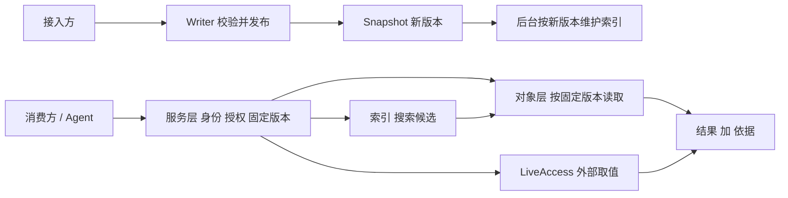

# 架构

## 分层

系统从下到上分五层。下层不认识上层：存储不认识对象，对象不认识插件，插件不绕过服务入口。

```text
入口层     kc 客户端 · HTTP · Go SDK · 只读挂载 kcfs · 控制台
服务层     统一的请求入口：身份、授权、固定版本、证据；装配与生命周期
插件层     声明式索引 · LiveAccess（横切能力，类似 AOP 切面）
对象层     对象身份、Aspect/Member/Relation、Schema、Writer、Reader、来源
存储层     Snapshot：仓、版本、条件提交、Dataset 交付（lakeFS）
```

| 层 | 负责 | 不负责 | 设计 |
|---|---|---|---|
| 存储层 | 保存文件和不可变版本，按仓划分权限，条件提交防并发覆盖，组合并交付 Dataset| 解释对象、Schema 或检索 | [Snapshot](design/snapshot.md)、[Dataset](design/dataset.md) |
| 对象层 | 按固定版本解释、校验和读取对象；Writer 是唯一发布入口 | 保存字节，外部状态 | [对象](design/object.md) |
| 插件层 | 在固定的连接点上提供搜索、外部取值、能力处理 | 发权、改写内容；索引不替代内容本身 | [插件](design/plugins.md)、[发现](design/discovery.md)、[LiveAccess](design/liveaccess.md) |
| 服务层 | 每次请求确定身份、范围和版本，检查授权，执行，留证；装配各层实例 | 定义对象模型或业务规则 | [服务](design/service.md)、[权限](design/permissions.md)、[治理](design/governance.md) |
| 入口层 | 让人和 Agent 发现能力、发起请求、看懂结果和失败 | 绕过服务层直接读存储 | [Affordance](design/affordance.md) |

只做文件交付时，只需要存储层和服务层；对象、索引、外部访问都可以不启用。这是“按需增加能力”
的基础。

## 代码目录对应

| 层 | 目录 | 说明 |
|---|---|---|
| 底座 | `kernel/` | 所有层都能用的最小概念：错误信封、摘要、仓和版本坐标 |
| 存储层 | `snapshot/` | 根包是存储合同；`dataset/`、`access/`、`service/`、`console/`、`client/`、`cli/` 是它的子能力；lakeFS 实现在 `snapshot/internal/` |
| 对象层 | `object/`、`systemrepo/` | 对象合同与读写；平台自描述出版物 |
| 插件层 | `discovery/`、`declarativeindex/`、`liveaccess/` | 通用发现合同与插件采用；按 Dataset 选进的索引声明维护的索引（OpenSearch）；外部取值，其处理器合同在 `liveaccess/handler/`，不对外暴露 |
| 服务层 | `server/`、`invocation/`、`home/`、`identity/`、`delivery/`、`observability/`、`hook/` | HTTP 处理与授权；应用调用载体；装配；身份；结果交付；访问证据；出站 Hook |
| 入口层 | `cli/`、`client/`、`invoke/`、`datasetfs/`、`cmd/` | 产品命令；调用方 SDK 与会话；命令与 HTTP 共用的调用词汇；只读挂载；可执行入口 |

目录在重组中，近期变化见[路线](roadmap.md)的“目录重组”。

## 三条运行路径

整个系统的运行可以用三条路径解释。



1. 发布路径：接入方经 Writer 提交修改。Writer 检查 Schema、身份和基于哪一版修改，通过后形成
   新版本。只有正式发布的版本才会被后续路径看到，草稿不算。
2. 使用路径：消费方的每次请求先由服务层确定身份、范围和版本，再检查授权。已知对象直接读；
   不知道对象时先搜索，搜索结果必须按同一版本回读内容，不能混用版本。需要当前状态时经
   LiveAccess 取值，结果同时记录内容版本和观察时间。
3. 维护路径：新版本发布后，后台按变化增量更新索引。索引失败不影响已经发布的内容，也不会
   让搜索把“索引未就绪”说成“没有结果”。

## 几条贯穿所有层的规则

- 版本固定：一次请求内所有读取都基于同一组版本。默认使用最新发布版，需要复核时用结果里的依据重读。
- 权限每次检查：Dataset 发布、对象引用、Affordance 说明都不发权。撤权后，旧依据也不能绕过当前权限。
- 写只有一个入口：所有发布都经过 Writer，不允许直接写存储绕过检查。
- 派生可重建：索引、缓存可以丢失重建，不能反过来当成内容权威。
- 缺能力要明说：没装配某个能力时明确失败，不降级成扫描或空结果。
- 对象身份不带仓：URN 只由带命名空间的 `object_id` 构成，仓只出现在方面和依据上，见[对象](design/object.md)。
- 插件声明是经 Writer 发布的对象：索引声明指向 Schema 字段、选进 Dataset 生效，取值来源写在方面或成员上；Schema 只描述结构。插件只作解释器，部署装了就按声明自动织入，不绑定 Dataset 或仓；搜索只以 Dataset 为范围，见[插件](design/plugins.md)。
- 多团队各自提交：不做跨仓事务，需要同时满足的约束靠固定一组版本。
