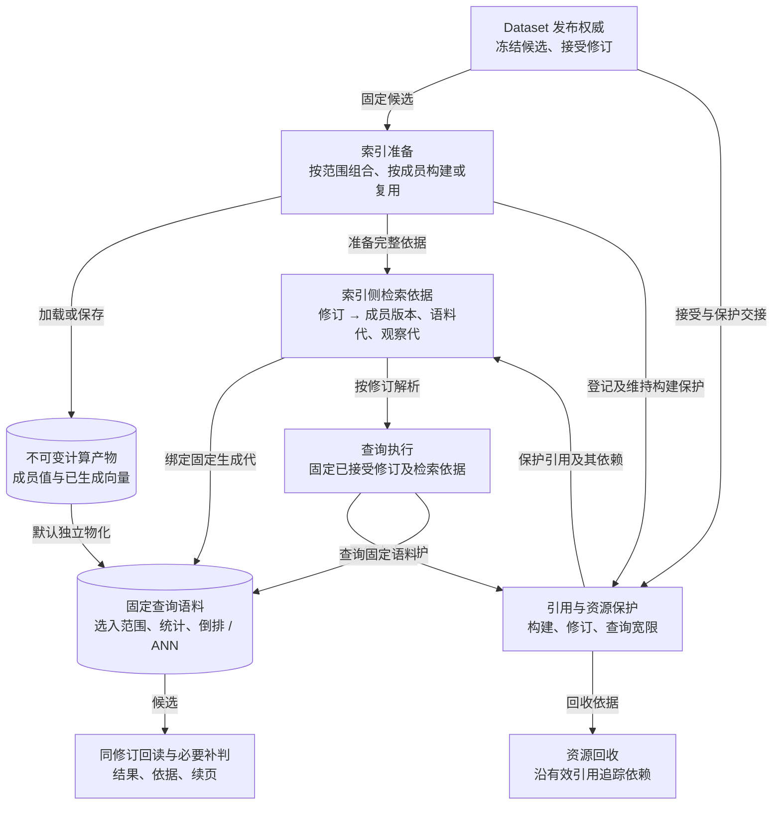
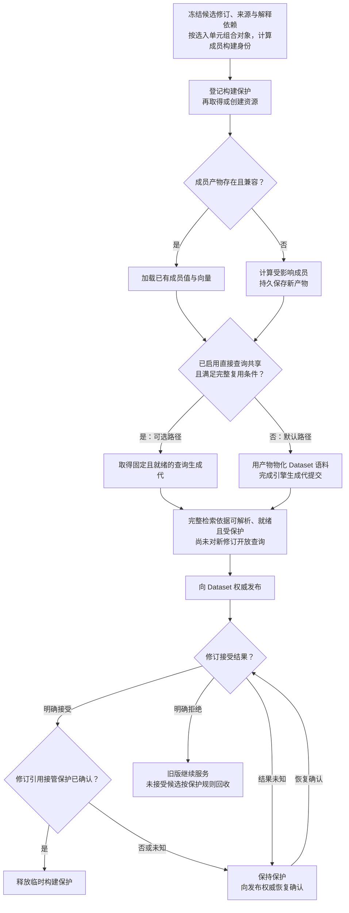
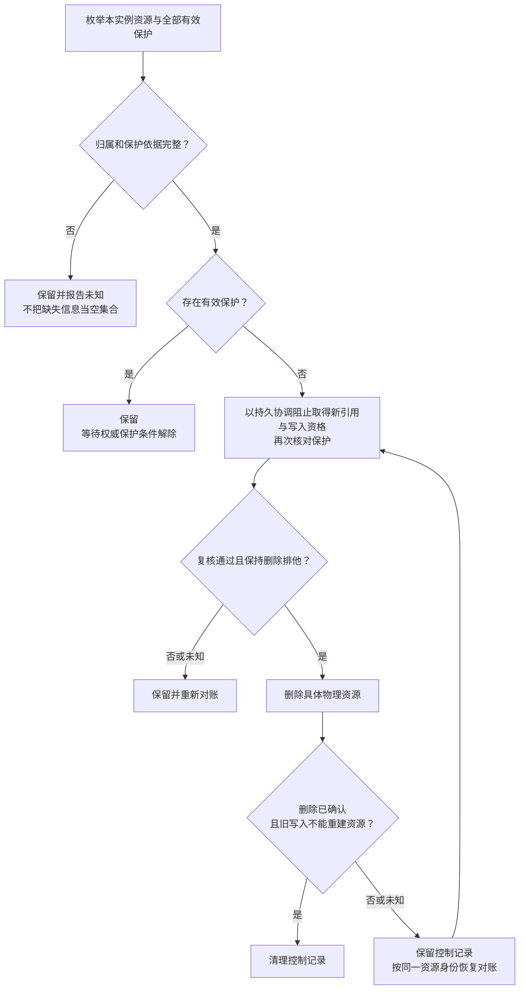

# 索引物理布局：复用、增量与回收（待重构）

本篇规定物理复用的边界、成员失效范围与资源保护依据。检索合同以[发现](discovery.md)为准，
版本保留与清除以[Dataset](dataset.md)为准，外部观察以[LiveAccess](liveaccess.md#规则)为准。
固定回读沿用[对象版本与读写](object-versioning.md#精确回读)的完整依据；实现选择与验收由
`INDEX-PHYSICAL-01` 维护。

## 总体架构

默认路径是复用不可变的成员计算产物，再为 Dataset 物化自己的查询语料。计算产物保存成员值和已生成
向量；查询语料承载选入范围、统一打分统计及倒排、ANN 等结构。两者的复用条件不同。

图按逻辑职责划分，不规定独立服务、索引或存储库。Dataset 发布权威负责接受修订；索引侧的检索依据将
该修订绑定到成员构建版本、固定语料和观察代，查询与回收使用同一组有效引用。产物载体、引用权威的
持久化位置及跨提交点交接协议仍待审查，图不表示它们已经共享一个事务。

## 准备与发布

手动发布和跟随发布使用同一路径。先固定选入单元与解释依赖、组合对象，再按成员判断复用，不能先构建
全对象再靠查询过滤修正范围。计算产物复用与直接查询结构复用是两个判断；后者为可选扩展。

新修订的成员输入未变时，仍须建立该修订自己的检索依据；Dataset 幂等重放沿用原发布结果，
[Writer 无变化命令](object-versioning.md#判据与结果)则不推进仓。不能为复用而制造提交或新修订；
外部观察刷新、能力变化核对与丢失资源恢复按各自维护需求执行，不以无变化命令发出仓推进通知为前提。

引擎生成代提交、Dataset 权威接受与引用保护交接是三个提交点。Dataset 接受前，检索依据必须已完整、
可解析且持续受保护；接受后的交接只确认修订引用接管，不能在这时才补齐查询所需的映射。
任一准备步骤失败都不进入发布，发布明确拒绝也保留旧版；发布结果未知或交接未确认时，保留保护并恢复
确认，不能直接按候选超时删除。

## 查询路径

1. 解析已接受的 Dataset 修订，核对消费权限、检索保留及续页有效性；`latest` 只在请求开始时解析。
2. 从该修订的检索依据固定成员构建版本、静态语料及观察代，核对就绪与兼容性。缺失或失效时明确失败，不切到 HEAD 或最新观察，也不在查询中触发构建。
3. 在固定语料内产生候选，使用该修订的完整固定读取依据回读并按观察合同补判，交付命中依据和续页。续页沿用原检索依据，所需资源由查询宽限保护。

外部观察刷新为当前修订准备受影响的观察产物与查询结构，接受新观察代时复查目标仍为当前修订；不改变
静态成员版本。已有请求与续页仍固定原观察代，保留修订不随之刷新。取值、补判与失效按 LiveAccess 合同执行。

同一修订采用新观察代时，按部署规定的续页宽限，为被替换的观察代固定并持久保存续页截止时间；后续刷新
和续页不顺延该期限。新查询使用该修订当前绑定的观察代。修订被替换后，最后采用的观察代随该修订的
检索保留及续页保护存续；更早观察代仍按原期限退出，不因修订继续保留而延长。

续页须同时满足 Dataset 生命周期与原观察代的有效期，多个适用截止时间取较早者。到期后拒绝新续页，
已经取得保护的在途请求仍按其有界请求期限保留依赖；最后一条有效保护解除后才可回收。期限与查询保护
在重启后仍可恢复，退役和紧急清除按各自合同优先执行。

## 资源保护与回收

物理保护沿资源的实际消费者及依赖计算，根包括：

- 当前及检索保留期内修订引用的生成代，和它们依赖的构建产物。
- 合同仍保护的在途查询与续页所需依据。
- 正在构建、验证或等待发布的候选及依赖；其保护须持久化、有期限且可续期。
- 经确认仍有消费者的独立投影需求。
- 请求证据与索引资源实际共享数据时，仍在证据保留期内的独立引用；只保护复核所需数据，不延长查询或续页有效期。

来源提交为读取而保留，不自动保护该提交的搜索投影；普通任务固定版本坐标也不延长检索保留。
共享资源在最后一条有效保护解除后才能回收，停止需求后后台不得重新生成已释放的投影。

固定读取依据和请求证据不能只存于可回收的查询生成代中。索引回收后，仍有效的本地读取依据在当前授权、
来源绑定及固定来源和解释依赖可用时仍能回读；原外部观察按 LiveAccess 证据合同复核。证据可独立保存，
也可单独引用实际共享值，但不能因保留证据而保护整套倒排或 ANN 结构。证据期限由其所属合同决定，
与检索保留分开执行；撤权限制访问，紧急清除按清除合同处理数据。

回收沿这些保护追踪到具体生成代和计算产物，而不是删除所有“非活动索引”：

取得新引用、取得写入资格与确认删除采用同一持久协调。保护过期的构建者不得继续创建资源、使暂存产物
可被复用或发布；已发出的写入和恢复后的旧构建者也不得重建已确认删除的资源。只在发布时检查资格不足以
保证回收完成，创建、写入完成与删除之间的隔离必须由所选载体和协调方案共同保证。

物理删除成功后，仍须确认迟到写入不能使资源重新出现，才能清理控制记录。尚不能确认时保留删除依据，
继续对账；暂存资源同样须可确权并有有界清理路径。保护未知时保留并报告，对账与重试在重启后继续；
报告资源归属、保留原因及删除结果。

共享资源与候选构建峰值纳入 Dataset 配额，归属规则由重构任务与配额合同确定。紧急清除按
[清除合同](dataset.md#紧急清除)关闭受影响访问、处理共享结构及观察证据，不受常规残值压缩安排推迟。

## 复用边界

复用提取、转换或向量计算的结果，仍可能需要重写对象文档、建立倒排或 ANN 结构，不能据此宣称避免了
全量物化。物理容器不必与 Dataset 修订或成员一一对应；直接共享查询结构须满足等价条件并有实际收益。

直接复用查询结构须同时满足：

- 实际选入的单元、对象组合、成员构建与 Schema 解释产生相同的值。
- 范围限制在候选产生前生效，范围外输入与未选成员不贡献匹配、排序、召回或归因。
- 词频、长度统计及召回结构符合该 Dataset 的逻辑语料；成员过滤不能代替统计隔离。
- 引用固定且就绪的生成代、成员构建版本与观察依据，并纳入发布、配额、保留和回收。别名不能随 HEAD 漂移。

例如，一个对象的 public 与 private 方面已拼成全文值，仅选 public 的 Dataset 不能靠查询侧对象过滤
复用该值。跨来源组成同一对象时，分别构建再合并候选也不一定等价于先组合对象再构建。多个成员共用文本
统计时，即使未选成员不再命中，其词频与长度仍可能改变排序和 top-k。

单来源全选、字段子集或来源数量少都不是充分条件。不能证明等价时，仍走独立语料准备；复用优化不能使
合法查询失去执行路径。无实际查询、准备或恢复消费者的来源投影停止维护，不因历史上存在而持续重建。

## 构建身份

成员键用于声明归因；不可变构建版本用于确定检索值。每个 Dataset 修订固定成员构建版本及语料依据，
同一成员改模板或模型不能覆盖旧修订的结果。判断能否复用的依据包括：

- 实际选入单元、缺失输入及解析后的 Schema 解释；跨仓组合保留来源版本向量。
- 成员的输入定位、组合、模板、缺值处理、规范化与截断规则。
- 实际参与构建的实现、分词器、同义词、模型及配置版本。

[对象状态摘要](object-versioning.md#比较的状态与范围)比较完整 Unit 的本地状态，不能直接充当成员产物的
复用键。摘要相同仍须核对解释依赖、构建配置和观察值；摘要不同也不必重算未受影响成员，例如同一 Unit
中未参与构建的字段变化。读取范围不同但成员有效输入与构建依赖一致时可以复用计算产物，查询范围仍各自兑现。

产物记录实际计算依赖；修订的读取依据沿用对象层对完整候选来源、逻辑选择规则、来源绑定和解释依赖的
固定合同，包括当时没有贡献内容的候选来源。来源的存储实例、仓库身份与固定版本用于追溯；有效输入及
构建依赖的摘要用于复用判断。复用旧产物不能沿用旧修订的来源依据，也不能从产物实际贡献者反推读取范围。
提交前进不等于所有成员失效，能力清单变化也只重新核对受影响成员。

内容经历 A → B → A 时，兼容且仍可安全取得引用的旧 A 产物可以复用，当前来源提交、Dataset 修订
和观察依据仍各自记录，不能合并历史修订。旧产物已回收时重新计算并取得新的物理资源身份，不恢复已删除的代。

复用产物的边界必须覆盖所承诺省去的计算：语义成员若要避免重复模型调用，须能保存和复用已生成的向量，
只保存输入文本不足以实现该目标。持久化位置与引擎接口由重构任务确定；查询结构的兼容性单独判断。

外部值另按观察规则处理：同一提交与 `shared` 均不能证明值不变。值及构建依赖一致时可复用计算产物，
每个修订仍绑定自己的观察依据；观察时间不充当值摘要，当前修订刷新不覆盖保留修订的旧观察。

## 成员增量

| 变化 | 处理范围 |
|---|---|
| 来源内容或选入范围变化 | 只重算有效输入变化的对象与成员；删除与范围缩减更新引用和查询结构 |
| 新增成员 | 计算新成员，复用未变化且兼容的产物 |
| 同键改变输入、模板、缺值规则、Schema 解释或构建依赖 | 形成该成员的新构建版本；按依赖重算，保留旧修订引用 |
| 退役成员 | 新修订解除引用；从匹配、聚合全文、打分统计与召回中排除其贡献 |
| 只改查询权重等查询配置 | 更新查询依据及确实依赖它的查询结构，不重算成员值 |
| 能力清单变化 | 逐成员核对实际解释与实现变化，保留不支持或失效的明确结果 |
| 全局存储格式不兼容 | 迁移受影响容器，仍兼容的计算产物继续复用 |

引擎要求整份对象或整个容器重写时，不扩大成员计算的失效范围。聚合全文与共享统计需要重建时，使用保留
成员的产物重新物化。残值只有在查询隔离得到证明时才可暂存，并须有有界的回收路径；不能等待偶然重建。

## 等价性与成本验证

以相同逻辑范围、成员构建及观察依据的独立重建为基准：精确检索在预算足够时，命中、排序、并列处理和
跨页结果一致；近似检索保持范围、模型、距离及打分语义，达到约定召回质量，不承诺不同 ANN 构建逐项相同。
预算耗尽按既有完整性与续页合同判断，不要求不同执行路径返回相同的部分集合。

计算复用、写入减少、空间减少和查询加速分别留证。默认路径的直接收益是减少重复成员计算和模型调用；
单对象变化时的写入量与发布时间是否随增量收敛，仍取决于查询语料的物化方式。

实施前按成员输入未变的新修订、单对象变化、成员增删改和连续观察刷新确定代表负载，分别给出计算复用的收益目标，
以及物化写入、稳定与峰值空间、发布与查询延迟的接受阈值。若独立语料的全量物化不能满足这些阈值，
须先调整物化方案或明确取舍，再实施；直接共享查询结构只是可选方案。指标与阈值由重构任务维护，
不能用其中一项改善代替其余成本的评估，也不能用范围、排序或完整性的变化换取收益。
