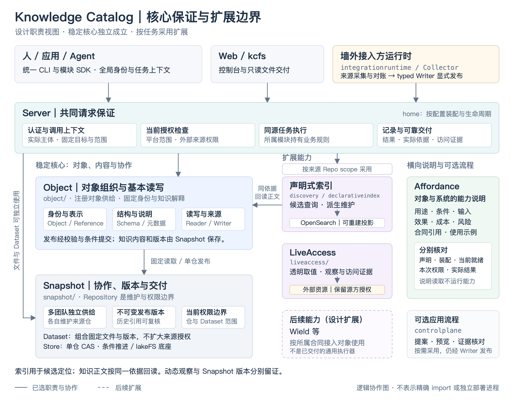
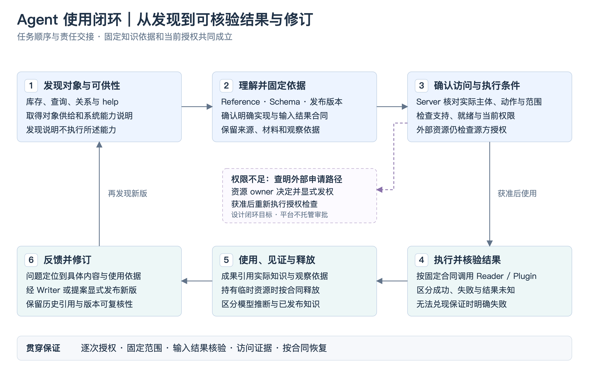

# 架构总览

## Goal

提供一个让人、应用与 Agent 共同使用对象的环境。不同团队可以发布、维护和组合自己的
对象；Agent 能自主发现对象，理解它能做什么，取得所需许可，按合同实际使用，并留下
可复核记录。对象可以是文档、图片、数据、代码、工具、服务或其他业务关注单元；读取
材料只是使用的一种方式，具体操作由对象的声明及适用实现决定。

Snapshot 仓承担多团队协作与生产所需的版本、发布、并发、范围和恢复保障。Object 层
组织对象的知识内容、身份、表示、Schema、元数据与来源，并提供基本固定读写。插件在
明确作用域内接入业务需要的发现、取值或操作能力。Affordance 同时说明注册对象与
系统自身能力，让 Agent 能沿统一环境找到可用动作及其条件、效果和成本。

自主性建立在真实授权、固定依据和执行记录之上。内容权威、派生索引与外部运行时各有
责任；组合不发权，能力说明不证明已就绪，观察不成为知识版本，插件不取得隐式写权。

## Non-Goals

- 不是检索应用，不是个人笔记库，也不是某个开源元数据产品的改包装。
- 不为运行面新增一套编号或协议层；应用服务负责装配与政策执行，不是新协议层。
- 仓登记与 Dataset 组合不取得知识解释职责；Knowledge 不因组合能力存在而让渡解释。
- 接入面与消费面不合并成一层；两者的权限模型、流量模型与扩展方向保持分离。
- 模块客户端不拥有 KC 的全局身份上下文、部署或宿主管理，也不因目录归属反向成为核心协议依赖。
- 不以 Agent 自主性替代资源拥有者的许可，也不把对象注册等同于任意内容自动可执行。

## 产品价值与目标形态

Knowledge Catalog 承担对象供给方与使用方之间的交接。供给方定义业务对象的边界，维护
内容、元数据和可供性，并交接实际材料或能力实现；使用方据此选择对象、取得许可并完成
任务。环境提供共同的存储、组织、作用域、发现、授权与记录机制，使业务扩展不必重建
整套对象基础设施。Object 是业务关注单元，知识表示描述它；实际内容与版本由 Snapshot
或明确外部来源承载，lakeFS 不决定业务对象身份。发布声明、装配实现、当前就绪和本次
获准分别成立，不能由一个知识提交互相推导。
一份知识可以供多个任务复用，一个任务也可以采用多个来源；复用必须保留各来源的维护
责任与权限边界。同名对象、不同口径和不同版本不能因组合而被悄悄揉成一份结论。

| 产品价值 | 要交付的使用者结果 |
|---|---|
| 独立供给 | 接入方按业务模型发布对象供给，维护知识与能力声明，日常操作无需部署方逐仓代办 |
| 协作与生产 | 团队有明确维护和授权边界，并发修订、发布采用、历史回读与故障恢复有可靠依据 |
| 按任务交付 | 维护者用 Dataset 选择文件范围和布局，消费者采用明确的发布版本与授权范围 |
| 自主使用 | Agent 从对象与系统的 Affordance 理解入口、前提及后果，获准后完成读取或已声明操作 |
| 同依据复核 | 结果能追溯使用者、对象范围、固定知识版本或实际来源观察，失败也保留可解释依据 |
| 持续修正 | 使用问题能定位到具体知识及使用依据，修订经正常写入或提案成为新版，历史消费仍可复核 |

可信表示内容、来源、版本、授权与处理依据可核对。Schema 合规、被平台接受或被模型引用，
都不能替代业务正确性判断；业务含义及其成立条件由知识维护者负责。

工程交付包括稳定协议与一致性合同、可部署且可恢复的参考服务，以及统一客户端和宿主
接入。用户通过同一产品完成发布与消费；界面首先呈现业务内容、交付范围、版本依据与
修订状态，存储连接和索引维护细节留在相应管理入口。当前服务的部署目标是可恢复单实例；
更大容量、独立进程或多副本按实际承诺取得证据，不从协议分层数量推导部署数量。

采用范围可以逐步增加：已有文件先通过 Snapshot 与 Dataset 组合交付；需要结构化读写时
由接入方增加知识身份、Schema 与来源；需要查询时声明逻辑访问能力；需要动态信息时
再接入外部资源访问与观察。普通文件交付不以知识建模或搜索服务为前提。

价值验证使用真实任务，观察新增来源与消费者的接入成本、任务完成质量、引用可复核性、
更新采用和故障恢复成本。协议一致性证明边界正确，任务评估证明这些保证是否改善使用
结果；两者分别需要证据。

对象供给的发布、发现、评估、访问、使用、见证与释放在对象系统设计中展开；这些是跨组件
责任，不是七个新增协议层。发布与发现可以形成独立交付切片，运行使用的保证仍应保留。

## 把面向对象的组织方式延伸到使用环境

供给方注册对象，环境连接它的定义、材料与适用能力，Agent 便能发现和访问这个对象。
注册首先交付可引用的对象供给：维护者确定业务身份，发布版本化定义、元数据、组成、
来源及 Affordance，并明确材料或实际能力的接点。对象的材料可以在 Snapshot 内，也可以
由外部资源承载；工具和服务通过明确实现提供动作。注册沿已有知识身份与 Writer 发布
成立，不另造对象登记权威。

环境进一步把供给连接为可用能力：按 Repo 作用域采用插件，由宿主管理已装配实例及其
依赖、启停与释放，由任务服务检查实际支持、就绪、当前授权和本次范围。声明和运行
分别交接；注册了一份工具说明后，具体实现仍需正确装配并符合其调用合同。基本对象
存储与固定读写独立成立，运行扩展按需增加。

这里借鉴 Spring 的组件定义、装配与管理思路。Spring 的 IoC 容器依据配置元数据组织
应用组件；KC 把这种组织思路延伸到可持续维护、跨团队供给且能被 Agent 发现的业务
对象环境。应用组件的实例管理仍归宿主和插件，对象身份、知识版本、跨仓引用与权限
继续由各自合同保证。这个延伸是 KC 的设计选择，依据见
[Spring 官方容器说明](https://docs.spring.io/spring-framework/reference/core/beans/basics.html)。

Agent 面对对象及系统的可供性选择动作，取得许可并调用适用入口，使用后留下依据。
对象引用和依赖关系帮助它理解协作；实际解析、访问及执行仍保持明确范围和责任。

## Agent 的对象使用闭环

Agent 应能沿「发现 → 理解与选择 → 申请并获准 → 使用 → 记录与修正」完成任务。
Affordance 既说明对象能提供的材料与操作，也说明环境自身的发现、发布、权限查询和
证据读取能力；不要求 Agent 先猜后台包名或存储路径。

| 环节 | 环境应提供的依据 |
|---|---|
| 发现与理解 | 有界发现及对象身份、来源、说明和适用的 Affordance；声明、支持、就绪分别可判断 |
| 申请与获准 | 明确缺少的许可和可达申请渠道，衔接资源拥有者或既有业务流程；批准后由管理者受控发权 |
| 使用 | 按任务选择作用域、固定依据和适用实现；实际请求重新鉴权，操作的影响与失败能够判断 |
| 留痕与修正 | 复核使用范围、知识版本、实际观察及执行结果；修订经正常写入和发布成为新版本 |

这描述设计闭环，不宣称已交付通用自主申请或审批系统。平台不托管申请／审批队列，
申请、业务批准和真正发权是不同动作；对象说明、Dataset 组合或一次旧授权均不能让
Agent 自行扩大权限。使用结果也不自动成为对象知识，采用与修订仍经显式发布。

## 分层架构

图按维护职责和内容权威组织，表示逻辑协作，不是 Go import 图或部署拓扑。共同服务
边界负责身份、请求范围、授权与记录，`home` 管理装配和生命周期；模块 CLI／SDK 通过
已认证服务入口工作。索引是可重建派生物，外部运行时保留自己的执行与权限责任。
控制提案与合并的现有应用流程可按任务使用，不成为所有对象操作必经的核心审批层。

两图可按完整尺寸打开：[职责与扩展边界](../assets/architecture/core-responsibilities.svg)、
[Agent 使用闭环](../assets/architecture/agent-use-loop.svg)。

扩展虚线表示未来方向。声明式索引与 LiveAccess 是当前两个具体插件方向；Wield 等
后续接入需要按真实能力选定输入、结果、作用域、执行影响与留证合同，不能只凭名称
承诺已可调用。可用性与实际验收由对应合同及运行证据回答。

## Snapshot Store 模块归属

Snapshot Store 是多团队协作与生产的共同底座：Repository 划维护和授权边界，不可变
版本固定已采用内容，条件提交保护并发修订，Dataset 负责跨来源的明确交付范围及版本。
来源仓更新不自动移动既有 Dataset；发布者决定何时采用新版本，历史使用仍有依据。
版本化文件存储、Dataset 文件组合交付、对应访问控制、HTTP 与完整 lakeFS 控制台属于
同一模块。源码在 `snapshot/` 下按 dataset、access、service、console 分开职责；上层
只通过根包及具名一级契约调用，不再持有一份相同实现。

模块的 typed SDK 与任务 CLI 分别归入 `snapshot/client`、`snapshot/cli`。
它们是具名公开一级入口，也是依赖核心合同的客户端适配；Snapshot 根、文件组合、访问控制、
HTTP 与静态控制台不反向依赖这两个入口。SDK 接受宿主注入的已认证运输，不另建身份或
会话账；模块 CLI 通过 SDK 表达文件任务，不直接打开权威或执行服务业务规则。
KC 保留全局身份上下文、部署、宿主管理和跨模块装配，将已认证会话交给模块入口。
迁移不生成新的命令树或独立二进制，不改既有任务语义；命令与帮助仍由同一注册合同驱动。

一套服务只有一个登记空间，不存在可创建、枚举、切换或单独归档的 Catalog 对象。仓登记与 Dataset 文件组合契约及权威实现归 Snapshot 的 dataset 一级包；底层 Store 合同仍独立且保持窄口。权限核心解释主体、动作和范围；外部业务动作、默认政策与知识解释由上层提供。原始文件交付不依赖 Knowledge、检索或语义投影，模块的 HTTP 入口不能通过 Home/Invocation 反向绑定完整 KC 应用。

Repository 与 Dataset 都可以保存可选自定义资源元数据。原生 Repository 属性由实际
Store 管理权威保存，服务接入其原生能力，不在登记账另造副本；Dataset 属性由组合服务
随不可变发布保存。相同的字符串键值形式不使两种资源拥有相同提交图或写入语义，资源
属性也不自动成为知识对象、查询索引或授权政策。该能力不读取或识别内容中的说明文件。

## Object 模块组织目标

Object 层解决对象内容怎样保存、解释及组织元数据的问题。它定义业务身份与知识表示、
组成及关系、Schema、来源和基本固定读写；保存字节、版本与条件推进的权威仍归
Snapshot。资源属性、对象知识和真实外部状态也不合并成一份元数据账。文件数量、目录
位置和 lakeFS 存储条目不定义业务对象；材料可分散在不同仓或外部，组成引用不使
Reader 自动跨仓组装，也不使外部运行时变成 Snapshot Store。

源码组织以 `object/` 承接 Knowledge 的基本身份、表示与读写，
`discovery/` 组织通用发现合同与组合，`declarativeindex/` 和 `liveaccess/` 分别组织具体
索引与当前态访问。通用 projection 保留消费合同和共享请求范围；具体 projection、control
和物理驱动同属发现实现，插件入口属于应用装配。目录迁移不扩大底层依赖许可。
此前 `interfaces/` 只定位既有固定操作合同，不定义独立能力层。基本读写独立成立，
各能力的 `service/` 承接所属请求，
部署宿主只装配；不新增笼统的对象应用容器。

系统保留 publish/discover/access 的授权、可信范围、固定依据、Writer/Dataset 接受、输出
核验、交付与证据；索引贡献通过消费方定义的注册/目标选择进入真实查询、准备和推进
路径，宿主构造实例并管理已有启停。声明式索引与其内部 OpenSearch 驱动分层，基本
固定读写和纯文件 Dataset 继续独立成立。绑定不执行 metadata、不发权，组合不自动继承。

插件提供具体实现，Affordance 说明对象与系统能力的使用合同，CLI/help 渐进呈现说明。
Repository 配置限定插件参与哪份供给；任务服务再按本次范围、需求与已认证身份选择
适用贡献。Dataset 使用来源仓的配置与固定声明，组合不会把一个仓的采用关系或权限
扩到所有成员。声明式索引负责按声明发现及维护投影，LiveAccess 负责来源取值、操作
及实际观察；业务可继续接入符合共同边界的扩展。

通用 Host、动态加载、热卸载与完整安装管理只在真实需要时提取。接入 Wield 等后续
能力时保留对象、作用域、授权、版本依据和留证边界，不先规定其运行或安装协议。
不能把出站 Hook 当成插件注册。具体接入过程与目标作用域由[插件接入设计](plugin-extension.md)拥有；
Object 自身合同与跨模块迁移沿[对象重构指南](object-refactor-guideline.md)。索引的声明、
维护和查询以及 LiveAccess 的具体执行仍由各自专题拥有，不在 Object 指南重复定义。

目录包含多个公开一级子能力不意味着根 Go 包反向依赖它们。`object/cache` 是可选上层
组件，由宿主持有及注入，仍不属于基础 Reader、Snapshot 或 Dataset 的具体状态。
跨模块只进入根或明确公开的一级包，并同时满足单向依赖。旧协议角色和现有公开合同继续
用于验证迁移的行为保证，不把旧包名或固定顶层目录数量当成新的协议约束。

## 内容权威与发现边界

| 组件 | 拥有什么 | 边界的理由 |
|---|---|---|
| Snapshot | 不可变版本、文件树、条件推进，以及独立的仓登记与 Dataset 文件组合能力 | 固定版本与组合交付必须独立于知识解释和检索存在 |
| Knowledge | 知识身份、Schema、能力合同、来源、读写与治理语义 | 同一份知识不能随路径、存储介质或入口改变解释 |
| Retrieval | 候选定位、查询计划与派生维护 | 检索可以替换、重建，不能决定正文是否已发布 |

原有 ⓪–③ 层号只用于内部依赖说明，不要求产品存在四个独立对象或请求依次经过四个步骤。
Dataset 组合使用底层 Store；Knowledge 自己解释固定来源内容，不把解释职责交给登记服务。

这些既有协议角色继续约束内容、组合与派生关系，产品分层见前面的结构图。两个
Snapshot 使用方可以连接不同仓；外部 runtime 通过所属任务的窄端口被访问。
应用服务不是新的协议层，具体依赖限制由现有架构守卫维护。

## 协议边界之内还要分清组件责任

协议边界不能代替完整组件设计。声明式索引决定知识允许怎样被查，索引控制使派生状态
满足持续服务需求，检索执行本次查询；三者分别承接声明变化、后台恢复与请求正确性。
Dataset 则管理消费范围和发布版本，与单个来源的写入生命周期分开。

权限体系决定身份与访问边界，应用服务在各入口强制执行。Hook 调用外部系统，Gate 检查
精确预览证据；二者协作但互不替代。CLI 负责用户怎样理解与完成任务，服务负责这些任务
如何调用同一应用能力。上述责任各有可独立评审的设计，不因为在同一进程里就压成一个段落。

对象组装的公开语义只有一条实现路径：保留两份组装实现靠人工同步，是提供方语义分叉的
入口。unit 代数只产出对象级变更，不包含路径、扩展名或序列化细节；文件编码只属于文件
提供方的编码层，让新提供方不必接受「文件」概念。跨请求的知识对象缓存也不属于协议边界
本身：底层 Snapshot、Dataset 与 Reader 不持有其具体实现，读取侧只暴露 Knowledge 拥有的同版本
hydrate 窄端口，完整对象与地址缓存由上层缓存组件实现并经应用装配根注入；该端口不提供
候选定位、知识写入、后台扫描或动态观察缓存。

## 三条路径足以解释运行

**发布知识。** 接入方把变更交给 Writer；校验和单仓条件提交成功，知识便已发布。
投影可以稍后追上，不能因为索引或通知失败撤销已经接受的提交。需要评审时先形成提案，
对固定预览取得证据，再合并目标仓。

**消费知识。** 应用服务先确定主体、授权和本次范围。已知身份直接读取；不知道身份时先
检索候选，再按候选的同一依据回读正文。Dataset 在请求开始时固定文件清单，读取、分页
和回读不能中途改用新的来源版本。

**维护派生状态。** 后台从固定版本或动态观察构建投影。通知只缩短延迟，对账承担恢复。
一次请求只选择可用能力；没有合适投影时明确失败，不能临时扫描全库或同步建索引。

动态观察的完整值可能需要独立保留，以支持原依据重读。这份证据与可删除的搜索索引不同，
但仍不成为 Snapshot 中的知识版本。需要把观察变成知识时，显式选择内容并经 Writer 发布。

## Snapshot 为什么保持简单

Snapshot 不解释知识身份、Schema 或查询。不可变版本让旧引用可复核，条件推进让并发写入
不会互相覆盖；只有文件读写、没有版本与条件提交的介质不能冒充它。能力不足应由协议明确
拒绝，而不是由上层猜测或模拟成功。

写入失败必须区分已证明没有发布与发布结果尚未确定。后者保留原请求的耐久占位，
不能让同一请求携带新内容再写；后续证据记录失败也不能抹去实际接受的提交。
lakeFS 发布协调残留不能靠超时推测为无人持有。恢复须先停止相关写入者，再核对目标与
残留候选的实际版本，显式释放协调残留；恢复本身不推进目标，也不代替写回执对账。

更换 Snapshot 底座的目标是新增适配器，而不是重写上层：判定对象是能力与跨提供方对拍
证据，不是接口形状相似。缺能力若不能在装配与一致性检查期暴露，只会在亿级对象上以全量
扫描或内存耗尽的形式暴露。替换若需要修改 Reader 或 Writer 的公开语义，即判定为抽象
破损——先修合同，不顺势改协议。变化识别（在两个固定坐标之间求差）因此是一等能力而
非可选性能件：缺失时退化是仓总量级的双全量比较，建投影路径必须显式失败，不得静默退化
为全量对账。规模权威提供方不得暴露绕过知识不变量的原始路径写入口；普通文件能力由明确
命名的适配层承担，不留在权威提供方上。公开消费面也不提供对象实例列举，全量遍历只属于
显式维护入口，其工作量受变更与目标规模约束。

当前部署采用 lakeFS。存储适配器决定怎样实现这些保证，不改变上层语义，也不要求本轮
扩展其它适配器。要更换后端时，采用条件同样是能力性的：有界读取、单仓原子写入、历史
可迁移与恢复要求，并用带环境与输入来源的规模证据验收；不能仅凭选型名称推出容量上限，
也不能反过来为迁就新介质修改知识协议。权威介质上的对象保留是一等约束：不得配置会清除
已提交历史版本的保留策略——按天数清理「已替换的已提交对象」会让旧版本坐标读不到正文，
即使版本图仍在也不满足固定依据回读的承诺。容量收敛由仓的代际边界承担，不由删历史承担；
垃圾回收只针对未提交残留与已废弃分支。

产品入口不能把通用存储设置权限当成删去固定依据的许可。没有证明所需历史仍可回读的
保留策略验证能力时，拒绝从产品接口修改已登记权威的垃圾回收策略；底层管理员仍须履行
同一部署约束，不能把代理入口的拒绝解释成对私网直接操作的防护。

持续运行不押注单个版本图无限增长：活动仓分代有界，旧代只读归档。旧版本坐标仍可显式
挂载读取，普通应用只见活动代；归档改变写入与生命周期边界，不等于物理压缩，垃圾回收
不能被描述成对仍可达历史的压缩承诺。

服务的登记与 Dataset 发布历史同样使用独立 Snapshot，不混入成员知识仓。

## 使用者应当看到的结果

- 接入方发布后能按回执版本读取知识；索引尚未追上时，看到的是检索未就绪，而不是写入失败。
- 消费方组合两个来源时仍能分辨各自身份与版本；同名对象不会因加载顺序覆盖。
- 外部状态改变可以更新动态查询，但知识仓版本和固定文件视图保持不变。
- 替换服务实例后恢复原登记与授权；丢失派生索引可以重建，丢失权威或承诺保留的证据不能假装初始化成功。

## 硬性约束 / Invariants

- 同一份知识不随路径、存储介质或入口改变解释；对象组装的公开语义只有一条实现路径。
- 读取侧只暴露 Knowledge 拥有的同版本 hydrate 窄端口；该端口不提供候选定位、知识写入、
  后台扫描或动态观察缓存。
- Snapshot 不解释知识身份、Schema 或查询；只有文件读写、没有版本与条件提交的介质不能
  冒充它。能力不足由协议明确拒绝，不由上层猜测或模拟成功。
- 替换底座若需要修改 Reader 或 Writer 的公开语义，判定为抽象破损：先修合同，不顺势改协议。
- 变化识别（两个固定坐标之间求差）是一等能力；缺失时建投影路径必须显式失败，不得静默
  退化为仓总量级的双全量比较。
- 规模权威提供方不得暴露绕过知识不变量的原始路径写入口；公开消费面不提供对象实例列举，
  全量遍历只属于显式维护入口。
- 权威介质上的对象保留是一等约束：不得配置清除已提交历史版本的保留策略；垃圾回收只针对
  未提交残留与已废弃分支。容量收敛由仓的代际边界承担，不由删历史承担。
- 索引或通知失败不能撤销已经接受的提交；投影可以稍后追上。
- 服务的登记与 Dataset 发布历史使用独立 Snapshot，不混入成员知识仓。
- 模块 CLI 与 SDK 依赖所属公开合同，核心不反向依赖客户端；认证会话由宿主提供，文件任务
  仍由同一服务权威执行（L-01、API-01、KS-01、AUTH-02）。

## 选定方案 / 被否决方案

- 选定当前部署采用 lakeFS；存储适配器决定实现方式，不改变上层语义，本轮不扩展其它适配器。
  更换后端的采用条件是能力性的（有界读取、单仓原子写入、历史可迁移与恢复要求）并用带
  环境与输入来源的规模证据验收；否决仅凭选型名称推出容量上限，也否决为迁就新介质修改
  知识协议。
- 选定跨请求知识对象缓存由上层缓存组件实现并经应用装配根注入；否决把缓存实现放进
  底层 Snapshot、Dataset 或 Reader。
- 选定活动仓分代有界、旧代只读归档来承载持续运行；否决押注单个版本图无限增长，也否决
  把垃圾回收描述成对仍可达历史的压缩承诺。
- 选定普通文件能力由明确命名的适配层承担；否决让权威提供方附带普通文件能力。
- 选定 Snapshot 自有 SDK 与任务 CLI、宿主注入已认证运输；否决把文件任务实现留在 KC
  再包一层转发，也否决让模块客户端接管全局身份、部署或直接打开后端权威。

## 接口契约 / 状态机

各能力的可执行形状由公开 Go API 承载：[Snapshot Store](../../snapshot/store.go) 与
[包用法](../../snapshot/README.md)、[Dataset 登记与组合](../../snapshot/dataset/README.md)、
[Snapshot SDK](../../snapshot/client/contract.go)、[CLI 操作合同](../../cli/SURFACE.md)、
[Knowledge](../../object/README.md)、[Retrieval](../../discovery/README.md)。
源码依赖方向与分层所有权由[架构守卫](../../internal/arch/README.md)持有，本文不复制
import 清单；接入「未提交或形成提案」与消费「先固定坐标再鉴权」的请求语义见各边界
Conformance。本文不复制方法、字段、错误码或适配器配置；也不以当前包拆分数量决定设计书篇数。
