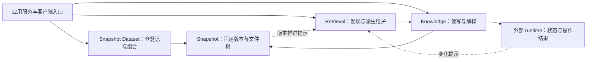

# 架构总览

## Goal

让不同团队供给可被发现、理解并按明确合同使用的业务对象，按任务组合材料与知识，
并在使用中持续修正。对象的知识表示承载版本化公开合同与说明，实际材料、状态和处理
逻辑可以位于不同位置。使用者能确定知识的身份、版本与来源，控制它怎样被修改，
并把不同来源组合起来消费；检索承担发现，外部运行时按固定合同提供状态或操作结果，
两者都不因此取得知识仓写权。系统用
Snapshot（含仓登记与 Dataset）、Knowledge、Retrieval 三个核心边界承载这些责任，消除「索引当正文、
组合当发权、观察当知识版本、后台恢复塞入一次请求」的边界混用。

## Non-Goals

- 不是检索应用，不是个人笔记库，也不是某个开源元数据产品的改包装。
- 不为运行面新增一套编号或协议层；应用服务负责装配与政策执行，不是新协议层。
- 仓登记与 Dataset 组合不取得知识解释职责；Knowledge 不因组合能力存在而让渡解释。
- 接入面与消费面不合并成一层；两者的权限模型、流量模型与扩展方向保持分离。

## 产品价值与目标形态

Knowledge Catalog 承担对象供给方与消费方之间的交接。供给方定义业务对象的边界，维护
其知识与能力声明，并交接实际材料或实现；平台承接发布、范围、授权、访问和版本依据，
消费方据此完成自己的任务。Object 是业务关注单元，知识表示描述它，Snapshot Store
保存内容和版本；lakeFS 承担底座，不决定业务对象身份。发布声明、装配处理器、当前可用
和本次授权分别成立，不能由一个知识提交互相推导。
一份知识可以供多个任务复用，一个任务也可以采用多个来源；复用必须保留各来源的维护
责任与权限边界。同名对象、不同口径和不同版本不能因组合而被悄悄揉成一份结论。

| 产品价值 | 要交付的使用者结果 |
|---|---|
| 独立供给 | 接入方按业务模型发布对象供给，维护知识与能力声明，日常操作无需部署方逐仓代办 |
| 按任务交付 | 维护者用 Dataset 选择文件范围和布局，消费者采用明确的发布版本与授权范围 |
| 同依据消费 | 人、应用和 Agent 能发现、理解并按合同使用对象，结果保留知识、材料或观察的可复核依据 |
| 持续修正 | 使用问题能定位到具体知识及使用依据，修订经正常写入或提案成为新版，历史消费仍可复核 |

可信表示内容、来源、版本、授权与处理依据可核对。Schema 合规、被平台接受或被模型引用，
都不能替代业务正确性判断；业务含义及其成立条件由知识维护者负责。

工程交付包括稳定协议与一致性合同、可部署且可恢复的参考服务，以及统一客户端和宿主
接入。用户通过同一产品完成发布与消费；界面首先呈现业务内容、交付范围、版本依据与
修订状态，存储连接和索引维护细节留在相应管理入口。当前服务的部署目标是可恢复单实例；
更大容量、独立进程或多副本按实际承诺取得证据，不从协议分层数量推导部署数量。

采用范围可以逐步增加：已有文件先通过 Snapshot 与 Dataset 组合交付；需要结构化读写时
由接入方增加知识身份、Schema 与来源；需要查询时声明逻辑访问能力；需要动态信息时
再接入外部资源访问与观察。普通文件交付不以知识建模或搜索服务为前提。

价值验证使用真实任务，观察新增来源与消费者的接入成本、任务完成质量、引用可复核性、
更新采用和故障恢复成本。协议一致性证明边界正确，任务评估证明这些保证是否改善使用
结果；两者分别需要证据。

对象供给的发布、发现、评估、访问、使用、见证与释放在对象系统设计中展开；这些是跨组件
责任，不是七个新增协议层。发布与发现可以形成独立交付切片，运行使用的保证仍应保留。

## Snapshot Store 模块归属

2026-10-12 的用户纠偏明确了产品模块边界：版本化文件存储、Dataset 文件组合交付、对应访问控制、HTTP 与完整 lakeFS 控制台属于同一 Snapshot Store 模块。源码在 `snapshot/` 下按 dataset、access、service、console 分开职责；上层 KC 只通过根包及具名一级契约调用该模块，不在上层、Invocation 或 Server 再持有一份相同实现。

一套服务只有一个登记空间，不存在可创建、枚举、切换或单独归档的 Catalog 对象。仓登记与 Dataset 文件组合契约及权威实现归 Snapshot 的 dataset 一级包；底层 Store 合同仍独立且保持窄口。权限核心解释主体、动作和范围；外部业务动作、默认政策与知识解释由上层提供。原始文件交付不依赖 Knowledge、检索或语义投影，模块的 HTTP 入口不能通过 Home/Invocation 反向绑定完整 KC 应用。

## Object 模块组织目标

业务 Object、关于它的知识表示和保存字节的 Snapshot Store 分属不同责任。对象模块维护
身份与表示合同，并提供基本固定读写；文件数量、目录位置和 lakeFS 的存储条目不定义业务
对象。对象的材料可以分散在不同仓或外部，组成引用不使 Reader 自动跨仓组装。

2026-10-12 选定的源码组织以 `object/` 承接现有 Knowledge 的基本身份、表示与读写，
`interfaces/`、`discovery/`、`liveaccess/` 同级提供通用能力、发现和当前态访问。发现的
逻辑合同与投影实现仍分开，基本读写不依赖上述扩展。各能力的 `service/` 承接所属请求，
部署宿主只装配；不新增笼统的对象应用容器。

目录包含多个公开一级子能力不意味着根 Go 包反向依赖它们。`object/cache` 是可选上层
组件，由宿主持有及注入，仍不属于基础 Reader、Snapshot 或 Dataset 的具体状态。
跨模块只进入根或明确公开的一级包，并同时满足单向依赖。旧协议角色和现有公开合同继续
用于验证迁移的行为保证，不把旧包名或固定顶层目录数量当成新的协议约束。

## 三个核心边界

| 组件 | 拥有什么 | 边界的理由 |
|---|---|---|
| Snapshot | 不可变版本、文件树、条件推进，以及独立的仓登记与 Dataset 文件组合能力 | 固定版本与组合交付必须独立于知识解释和检索存在 |
| Knowledge | 知识身份、Schema、能力合同、来源、读写与治理语义 | 同一份知识不能随路径、存储介质或入口改变解释 |
| Retrieval | 候选定位、查询计划与派生维护 | 检索可以替换、重建，不能决定正文是否已发布 |

原有 ⓪–③ 层号只用于内部依赖说明，不要求产品存在四个独立对象或请求依次经过四个步骤。
Dataset 组合使用底层 Store；Knowledge 自己解释固定来源内容，不把解释职责交给登记服务。

图表示职责之间的协作，不是 Go import 图。两个 Snapshot 使用方可以连接不同仓；
外部 runtime 通过 Knowledge 拥有的窄端口被访问。应用服务负责装配与政策执行，
不是新的协议层。具体依赖限制仍由现有架构守卫维护。

## 协议边界之内还要分清组件责任

四个协议边界不能代替完整组件设计。声明式索引决定知识允许怎样被查，索引控制使派生状态
满足持续服务需求，检索执行本次查询；三者分别承接声明变化、后台恢复与请求正确性。
Dataset 则管理消费范围和发布版本，与单个来源的写入生命周期分开。

权限体系决定身份与访问边界，应用服务在各入口强制执行。Hook 调用外部系统，Gate 检查
精确预览证据；二者协作但互不替代。CLI 负责用户怎样理解与完成任务，服务负责这些任务
如何调用同一应用能力。上述责任各有可独立评审的设计，不因为在同一进程里就压成一个段落。

对象组装的公开语义只有一条实现路径：保留两份组装实现靠人工同步，是提供方语义分叉的
入口。unit 代数只产出对象级变更，不包含路径、扩展名或序列化细节；文件编码只属于文件
提供方的编码层，让新提供方不必接受「文件」概念。跨请求的知识对象缓存也不属于协议边界
本身：底层 Snapshot、Dataset 与 Reader 不持有其具体实现，读取侧只暴露 Knowledge 拥有的同版本
hydrate 窄端口，完整对象与地址缓存由上层缓存组件实现并经应用装配根注入；该端口不提供
候选定位、知识写入、后台扫描或动态观察缓存。

## 三条路径足以解释运行

**发布知识。** 接入方把变更交给 Writer；校验和单仓条件提交成功，知识便已发布。
投影可以稍后追上，不能因为索引或通知失败撤销已经接受的提交。需要评审时先形成提案，
对固定预览取得证据，再合并目标仓。

**消费知识。** 应用服务先确定主体、授权和本次范围。已知身份直接读取；不知道身份时先
检索候选，再按候选的同一依据回读正文。Dataset 在请求开始时固定文件清单，读取、分页
和回读不能中途改用新的来源版本。

**维护派生状态。** 后台从固定版本或动态观察构建投影。通知只缩短延迟，对账承担恢复。
一次请求只选择可用能力；没有合适投影时明确失败，不能临时扫描全库或同步建索引。

动态观察的完整值可能需要独立保留，以支持原依据重读。这份证据与可删除的搜索索引不同，
但仍不成为 Snapshot 中的知识版本。需要把观察变成知识时，显式选择内容并经 Writer 发布。

## Snapshot 为什么保持简单

Snapshot 不解释知识身份、Schema 或查询。不可变版本让旧引用可复核，条件推进让并发写入
不会互相覆盖；只有文件读写、没有版本与条件提交的介质不能冒充它。能力不足应由协议明确
拒绝，而不是由上层猜测或模拟成功。

更换 Snapshot 底座的目标是新增适配器，而不是重写上层：判定对象是能力与跨提供方对拍
证据，不是接口形状相似。缺能力若不能在装配与一致性检查期暴露，只会在亿级对象上以全量
扫描或内存耗尽的形式暴露。替换若需要修改 Reader 或 Writer 的公开语义，即判定为抽象
破损——先修合同，不顺势改协议。变化识别（在两个固定坐标之间求差）因此是一等能力而
非可选性能件：缺失时退化是仓总量级的双全量比较，建投影路径必须显式失败，不得静默退化
为全量对账。规模权威提供方不得暴露绕过知识不变量的原始路径写入口；普通文件能力由明确
命名的适配层承担，不留在权威提供方上。公开消费面也不提供对象实例列举，全量遍历只属于
显式维护入口，其工作量受变更与目标规模约束。

当前部署采用 lakeFS。存储适配器决定怎样实现这些保证，不改变上层语义，也不要求本轮
扩展其它适配器。要更换后端时，采用条件同样是能力性的：有界读取、单仓原子写入、历史
可迁移与恢复要求，并用带环境与输入来源的规模证据验收；不能仅凭选型名称推出容量上限，
也不能反过来为迁就新介质修改知识协议。权威介质上的对象保留是一等约束：不得配置会清除
已提交历史版本的保留策略——按天数清理「已替换的已提交对象」会让旧版本坐标读不到正文，
即使版本图仍在也不满足固定依据回读的承诺。容量收敛由仓的代际边界承担，不由删历史承担；
垃圾回收只针对未提交残留与已废弃分支。

持续运行不押注单个版本图无限增长：活动仓分代有界，旧代只读归档。旧版本坐标仍可显式
挂载读取，普通应用只见活动代；归档改变写入与生命周期边界，不等于物理压缩，垃圾回收
不能被描述成对仍可达历史的压缩承诺。

服务的登记与 Dataset 发布历史同样使用独立 Snapshot，不混入成员知识仓。

## 使用者应当看到的结果

- 接入方发布后能按回执版本读取知识；索引尚未追上时，看到的是检索未就绪，而不是写入失败。
- 消费方组合两个来源时仍能分辨各自身份与版本；同名对象不会因加载顺序覆盖。
- 外部状态改变可以更新动态查询，但知识仓版本和固定文件视图保持不变。
- 替换服务实例后恢复原登记与授权；丢失派生索引可以重建，丢失权威或承诺保留的证据不能假装初始化成功。

## 硬性约束 / Invariants

- 同一份知识不随路径、存储介质或入口改变解释；对象组装的公开语义只有一条实现路径。
- 读取侧只暴露 Knowledge 拥有的同版本 hydrate 窄端口；该端口不提供候选定位、知识写入、
  后台扫描或动态观察缓存。
- Snapshot 不解释知识身份、Schema 或查询；只有文件读写、没有版本与条件提交的介质不能
  冒充它。能力不足由协议明确拒绝，不由上层猜测或模拟成功。
- 替换底座若需要修改 Reader 或 Writer 的公开语义，判定为抽象破损：先修合同，不顺势改协议。
- 变化识别（两个固定坐标之间求差）是一等能力；缺失时建投影路径必须显式失败，不得静默
  退化为仓总量级的双全量比较。
- 规模权威提供方不得暴露绕过知识不变量的原始路径写入口；公开消费面不提供对象实例列举，
  全量遍历只属于显式维护入口。
- 权威介质上的对象保留是一等约束：不得配置清除已提交历史版本的保留策略；垃圾回收只针对
  未提交残留与已废弃分支。容量收敛由仓的代际边界承担，不由删历史承担。
- 索引或通知失败不能撤销已经接受的提交；投影可以稍后追上。
- 服务的登记与 Dataset 发布历史使用独立 Snapshot，不混入成员知识仓。

## 选定方案 / 被否决方案

- 选定当前部署采用 lakeFS；存储适配器决定实现方式，不改变上层语义，本轮不扩展其它适配器。
  更换后端的采用条件是能力性的（有界读取、单仓原子写入、历史可迁移与恢复要求）并用带
  环境与输入来源的规模证据验收；否决仅凭选型名称推出容量上限，也否决为迁就新介质修改
  知识协议。
- 选定跨请求知识对象缓存由上层缓存组件实现并经应用装配根注入；否决把缓存实现放进
  底层 Snapshot、Dataset 或 Reader。
- 选定活动仓分代有界、旧代只读归档来承载持续运行；否决押注单个版本图无限增长，也否决
  把垃圾回收描述成对仍可达历史的压缩承诺。
- 选定普通文件能力由明确命名的适配层承担；否决让权威提供方附带普通文件能力。

## 接口契约 / 状态机

各能力的可执行形状由公开 Go API 承载：[Snapshot Store](../../snapshot/store.go) 与
[包用法](../../snapshot/README.md)、[Dataset 登记与组合](../../snapshot/dataset/README.md)、
[Knowledge](../../knowledge/README.md)、[Retrieval](../../retrieval/README.md)。
源码依赖方向与分层所有权由[架构守卫](../../internal/arch/README.md)持有，本文不复制
import 清单；接入「未提交或形成提案」与消费「先固定坐标再鉴权」的请求语义见各边界
Conformance。本文不复制方法、字段、错误码或适配器配置；也不以当前包拆分数量决定设计书篇数。

## 协议入口
