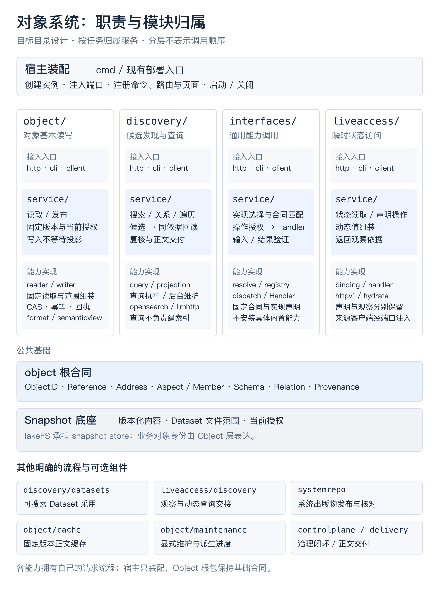
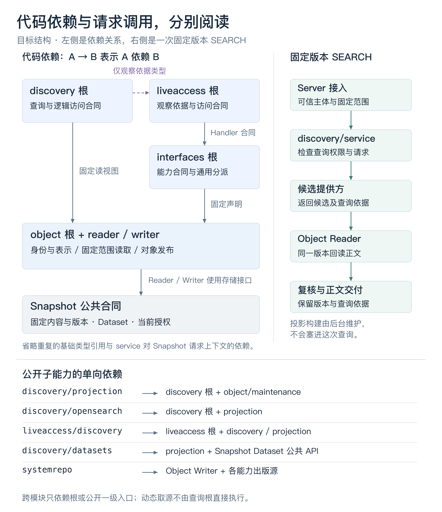

# 对象模块重构 Guideline

日期：2026-10-12；2026-10-13 补入插件扩展体系及 CLI 调整边界。定位：已选定的重构目标与执行指南，供设计、迁移和评审反复查阅。
本文的目录树和图均表示目标结构；当前主要实现仍使用 `knowledge`、`retrieval`、`index`、
`knowledgeapp` 等路径。保存本指南不代表代码迁移或业务验收已经完成。

## Goal

在 Snapshot Store 上建立业务对象的合同与访问能力，近期聚焦发布与发现，最终支持发布
可被理解、选择和使用的对象。目录围绕能力所有权组织，使基本对象读写可以独立使用，
通用能力、发现和当前态访问可以在其上独立演进。

publish、discover、access 的任务过程由系统定义，业务通过有作用域的插件参与明确阶段。
本指南拥有系统核心、插件宿主、标准插件及安装生命周期的目标边界；具体注册形状仍由
所属能力的公开类型、包 README 与 Conformance 在实施时选定。

本文确定模块归属、公开依赖深度、请求责任、现有代码迁移方向和实施检查点。对象供给
全景、Schema、Interface、查询和授权的语义仍由原主题 owner 拥有；文档关系与主题归属
统一登记在 `docs/graph/`。迁移不能以当前实现的便利反向收窄这些设计。

## Non-Goals

- 本指南不实施源码移动、协议改名、system 出版物更新或新增产品能力。
- 不重新设计正在重构的 `snapshot/` 内部；上层采用其公开合同，不依赖 lakeFS 实现。
- 不引入对象类型注册表、统一资源包装、第二套全局身份或强制 definition / Interface。
- 不把外部源在线、处理器装配、投影就绪或业务说明完整性变成基本发布的前置条件。
- 不预先限定外部对象的表示、运行语言、进程边界或所有能力的访问与释放方式。
- 不添加第二种索引声明形式，不把查询机制强行登记到通用 Interface 注册表。
- 不保留旧新双实现或新增兼容转发层作为目标；分批迁移不等于长期提供两套入口。
- 不为目录完整创建空包、通用应用框架或新的认证会话；插件宿主只承接本篇明确的注册、
  作用域与生命周期，不成为第五个协议边界或逐请求业务容器。
- 不因插件化改写既有 CLI 能力、授权 Action、操作或结果合同；新增插件管理任务先单列
  合同和验收，不在本轮预设公开命令、消息字段或持久状态机。
- 不把 Repo/Dataset 安装作用域解释为任意业务代码的运行隔离，不凭受限接口宣称代码沙箱。

## 1. 先分清对象、表示与存储

| 内容 | 所有者与责任 |
|---|---|
| 业务 Object | 领域中被独立指认、供给和使用的关注单元；领域决定边界与身份延续 |
| 对象的知识表示 | 关于对象的定义、组成、事实、说明、来源、能力与使用条件；由 Object 读写合同维护 |
| 版本化存储 | Snapshot Store 保存固定内容与版本，并控制条件推进；lakeFS 提供存储实现 |

图片资产可以替换原图而保持业务身份；模块可以关联不同目录、不同仓中的源码和合同；
外部表可以始终留在源系统中。三者都能发布知识表示，但不因此要求其全部材料进入同一目录
或 Snapshot。普通文件也不会仅因存入 lakeFS 就自动成为业务对象。

稳定引用由 Repository 与 ObjectID 指认平台中的表示，固定引用再带上版本依据。ObjectID
是上层代码感知的强约定，不能从文件路径推导，也不要求另建跨仓全局身份服务。固定版本
固定的是表示及明确引用的材料；它不冻结外部表的当前值。

对象组成与读取组装分开：组成引用表达对象关联了什么，Reader 按请求组装同仓、同版本、
允许范围内的知识单元。引用不同仓或外部材料，不触发自动读取、跨仓 Canonical 或隐式授权。

| 表示与合同 | 在设计中的位置 |
|---|---|
| Aspect | 关于对象的一个维护角度；对象定义、人工补充和衍生说明都可作为普通 Aspect |
| Member | 集合型 Aspect 内可独立寻址、维护的稳定单元；不是任意资源文件的别名 |
| Address | Object、Aspect、Member 等维护单元的逻辑地址；不等于物理文件路径 |
| Schema | 约束采用它的表示结构；Schema 本身经 Writer 发布，业务 Schema 不编进源码名单 |
| Relation | 独立维护的关系记录，通过引用连接对象；端点不因被引用而自动读取或获权 |
| Interface | 根据共同处理逻辑规定能力合同、对象实现要求和结果保证；运行处理器独立装配 |
| 可供性 | 关联明确实现与操作的用途、条件、效果和限制；帮助选择，不授予权限或证明可用 |
| 声明式索引 | 唯一写在 Schema 字段的 access 中；逻辑解释、物理兑现和查询执行分别负责 |

这些概念有不同责任，不要求每个对象都具有全部声明。描述中提及一种能力，不等于对象
已经实现它；实现声明可读，也不等于处理器已支持或当前主体可以调用。

## 2. 能力归属



此图表示职责和包含关系，没有调用先后含义。
[可编辑 SVG](../assets/object-refactor/object-ownership.svg)。

| 模块 | 提供的能力 | 边界 |
|---|---|---|
| `snapshot/` | 固定字节、版本、Dataset 文件组合、对应权限、lakeFS 与产品入口 | 不解释业务 Object、Aspect、Schema 或 Interface |
| `object/` | 稳定身份、逻辑地址、表示与唯一组装语义、结构和关系合同、来源、固定读写 | 基本读写不依赖发现、通用分派或外部访问 |
| `interfaces/` | 通用能力定义、实现声明解释、注册匹配、分派与输入结果校验 | 不内置业务类型 switch，不依赖 LiveAccess 才能调用其它能力 |
| `discovery/` | 字段 access 解释、查询计划、候选定位、关系导航、同依据回读及发现交付 | 根合同与查询不反向依赖具体投影实现；一次查询不启动后台恢复 |
| `liveaccess/` | 当前态访问合同、固定 Binding 解释、处理器、来源端口与实际观察依据 | 依赖 Object 与 Interfaces；不实现 Snapshot Store，不把观察当固定正文 |
| `systemrepo/` | 平台自描述内容的完整出版、显式发布和核对 | 不属于 Object 信任根；启动只核对，不补发布 |
| `plugins/` | 插件包与安装实例、依赖、可撤销注册、作用域视图及资源生命周期 | 不拥有请求授权、Writer、查询规划或来源执行规则；具体注册组合在产品装配处完成 |

`object/` 包含基本 Reader 和 Writer，不另设 `objectio`。通用能力、发现和当前态访问
各有独立概念与依赖，保持同级；不使用 `objectcore`、`objectinterfaces` 等前缀。

模块归属和插件实体是不同维度：Object 基本读写、通用分派和任务执行边界属于系统核心；
声明式索引、LiveAccess 等标准插件利用这些边界交付具体实现。一个插件可以贡献多个阶段，
不能把整个模块交给插件后连同授权、依据核验和交付规则一起替换。图示表达模块所有权，
插件实例与任务参与关系由下文第 6 节补充。

**根 Go 包与目录模块不是同一层概念。** Object 根包提供基础合同，Reader、Writer、缓存、
维护与服务是模块中的具名子能力。根包不为了统一入口而导入这些依赖根合同的实现；例如
`object/cache` 可位于模块内，但不能使 Reader 持有具体缓存状态。

## 3. 目标目录树

文件名表达职责和建议落点，具体拆分以职责、体积和依赖为依据。测试与合同跟随代码所有者；
下树省略重复的测试文件，不代表可以省略验证。仅创建本批实际需要的目录与公开入口。

```text
snapshot/                           # 正在重构的完整模块，内部由其 owner 确定
                                    # Dataset、权限、存储、lakeFS、CLI/HTTP/Console

object/
├── README.md
├── identity.go                     # ObjectID、稳定引用、固定版本引用
├── address.go                      # 维护单元的逻辑寻址
├── value.go                        # 表示值与单元声明
├── assemble.go                     # 唯一的对象组装语义
├── changeset.go                    # 对象变更合同
├── schema.go
├── schema_ref.go
├── schema_structure.go             # 结构合同与引用解释
├── relation.go
├── provenance.go                   # 来源及衍生依据
├── source.go                       # 取值来源与 Binding 的纯声明合同
├── hydration.go                    # 同版本 Hydrator 窄口及输出核验
├── trusted_schema.go               # 基础对象协议的可信 Schema 数据
├── reader/
│   ├── reader.go  repository.go  scope.go
│   └── schema.go  history.go  ports.go
├── writer/
│   ├── writer.go  commit.go  propose.go  schema.go
│   └── receipt.go  idempotency.go  preview.go  ports.go
├── service/
│   └── read.go  write.go  schema.go  history.go  ports.go
├── format/                         # 公开的一层解析、序列化入口
├── semanticview/                   # 固定表示的语义文件视图
├── cache/                          # 可选正文缓存，由宿主持有并注入
├── maintenance/
│   └── scan.go  change.go  file_scope.go
│       consumer.go  coordinator.go  progress.go
├── client/                         # 对象任务的 typed Client
├── http/                           # 对象 HTTP 接入
├── cli/                            # 对象命令，经 Client/Server
└── internal/
    └── codec/  bodycache/  maintenance/

interfaces/
├── README.md
├── definition.go  implementation.go
├── registry.go  dispatch.go  values.go  ports.go
├── service/
│   └── resolve.go  invoke.go  evidence.go  ports.go
├── client/  http/  cli/
└── internal/

discovery/
├── README.md
├── access.go  fields.go             # 逻辑字段、适用资格与 access 解释
├── query.go  result.go  plan.go  continuation.go  ports.go
├── service/
│   └── search.go  relations.go  traverse.go
│       describe.go  refine.go  ports.go
├── projection/
│   └── document.go  compiler.go  sync.go
│       generation.go  readiness.go  snapshot_consumer.go  ports.go
├── plugin/                         # 声明式索引插件的具名注册与构造入口
├── datasets/
│   └── publish.go  reconcile.go     # 可搜索 Dataset 的准备与采用流程
├── opensearch/                     # 公开一级 provider 入口
├── llmhttp/                        # 模型筛选/重排适配入口
├── client/  http/  cli/
└── internal/
    └── opensearch/  llmhttp/

liveaccess/
├── README.md
├── contract.go  declaration.go  binding.go
├── handler.go  observation.go  ports.go
├── service/
│   └── access.go  hydrate.go  evidence.go  ports.go
├── httpv1/                         # 来源访问的参考传输适配器
├── discovery/                      # 可选动态发现桥接
│   └── source.go  refresh.go  notices.go  internal/
├── plugin/                         # LiveAccess 注册；动态发现桥接可单独启用
├── client/  http/  cli/             # 仅保留实际需要的专用入口
└── internal/

systemrepo/
├── README.md
├── publication.go  publish.go  verify.go
├── content/                        # 平台完整出版物
└── cli/                            # 显式管理入口

plugins/                            # 产品扩展机制，不是对象/查询协议
├── README.md
├── host.go  context.go              # 实例构造、依赖及受限服务注入
├── binding.go  lifecycle.go         # 安装作用域、可撤销注册、取消和关闭
└── internal/

controlplane/                       # 提案、预览、验证与条件合并
delivery/                           # 内容交付政策及当前权限复核
observability/                      # 运行诊断
connector/  integrationruntime/     # 采集及外部接入运行环境
client/  identity/  invoke/          # 保留已有通用身份、会话与传输合同
cmd/
├── kc/
├── kcfs/
└── kc-integration/                 # 产品宿主与装配入口
internal/arch/                      # 真实包依赖和公共入口守卫
docs/graph/                         # 文档主题与关系的唯一登记处
.data/scenes/                       # 协议旅程及其材料
```

`interfaces` 使用复数，避免 Go 关键字 `interface`。一个新的 Interface 通常复用通用调用
入口，不必额外创建专用 Client、HTTP 和 CLI。现有 Dataset 页面归 Snapshot Console；
本次目标不凭空增加独立 Object Console。

## 4. service 的边界与专门流程

`service/` 提供一项明确任务的请求级保证：取得可信上下文，检查当前动作和范围，固定本次
依据，调用所属能力，执行交付政策并记录所需证据。每种任务只有一条规则实现路径，
HTTP 和 CLI 不各自维护授权、版本选择或结果复核逻辑。

| 任务 | 所有者 | 不应放在哪里 |
|---|---|---|
| 固定读、Schema 浏览、历史、对象写入 | `object/service` | 不通过发现或当前态访问才能执行 |
| SEARCH、RELATIONS、遍历、访问合同说明 | `discovery/service` | 不放在 Object Reader 或 HTTP handler |
| 解析明确实现并统一调用 Interface | `interfaces/service` | 不要求存在 LiveAccess 来源端口 |
| 当前态取值与按实际观察依据回读 | `liveaccess/service` | 不混入固定 Reader 或通用 Registry |
| 可搜索 Dataset 的准备、采用与恢复 | `discovery/datasets` | 不反向引入 Snapshot 核心，也不堆入部署宿主 |
| 完整系统出版物的显式发布与核对 | `systemrepo` | 不由基础 Writer 导入完整出版物 |
| 提案、证据与条件合并 | `controlplane` | 不新增另一条 Object 写入代数 |

CLI 经 typed Client 和 Server，以显式 principal 进入相同任务服务。通用认证、会话及证据
基础设施复用现有能力，各模块不复制 Server 或身份栈。HTTP 接入只负责传输解释；不同任务
可以有不同 executor，但同一任务不能因入口不同而出现两个 executor。

可搜索 Dataset 流程先固定候选，准备它承诺的查询能力，再条件接受发布；准备失败保留旧
服务版，不撤销来源已接受提交。纯文件 Dataset 的发布不要求索引，仍由 Snapshot 提供。

宿主选择具体 provider，构造服务，注入端口，注册入口，恢复并启动后台任务，最后关闭组件。
宿主不执行某次查询、某个对象的授权和 hydrate，或某次 Dataset 采用的业务判定。原 `home`
中的配置与生命周期可保留装配责任，不能借保留路径继续持有请求规则。

## 5. 依赖方向与公开深度



左侧箭头表示代码依赖；右侧表示请求中的调用顺序。省略重复基础类型引用及各服务对当前
授权、范围和交付端口的依赖。[可编辑 SVG](../assets/object-refactor/object-dependencies-and-search.svg)。

跨模块只依赖上游模块根或**明确公开的一级子能力**。以 `a/b` 是模块为例，允许进入
`a/b`、`a/b/d`，不允许进入 `a/b/c/d`；不能把任意深层目录临时称为模块来绕过限制。
同一模块可有更深的私有组织，实际 Go package 仍必须无循环。

检查分两步：先判断 A 是否应依赖 B，再检查目标是否是 B 的公开入口。一层深度合法不会
自动授予依赖许可；一级目录也不会仅因存在就成为公开 API。公开入口须有边界、最小用法
和验证，语言级 `internal/` 与架构守卫共同保护实现。

| 依赖方 | 允许采用的主要合同或入口 | 关键限制 |
|---|---|---|
| `object` 根 | 基础坐标、错误、摘要等底层词汇 | 不导入 Reader/Writer 或扩展运行实现 |
| `object/reader`、`writer` | Object 合同、编码语义与 Snapshot 窄口 | 读端口不暴露写能力；不依赖发现或当前态 |
| `object/service` | 基本 Reader/Writer、Snapshot 范围与当前权限、交付端口 | 不建立通用应用容器 |
| `object/cache` | Object Hydrator 合同 | 不反向进入 Reader，不缓存授权决定或动态观察 |
| `object/maintenance` | Object、固定读取及 Snapshot 版本推进合同 | 不知道搜索 READY、来源客户端或 State 队列 |
| `interfaces` / `service` | Object 合同、有界固定声明读取、当前权限与证据端口 | 不为注册内置实现而导入 LiveAccess |
| `liveaccess` / `service` | Object、Interfaces、固定声明及来源访问端口 | 具体传输经注入；固定声明不冻结外部值 |
| `discovery` / `service` | Object 固定读取、Snapshot 请求范围、交付；LiveAccess 观察依据类型 | 观察类型依赖不等于来源访问；根不导入 projection/provider |
| `discovery/projection` | Discovery 逻辑合同、Object 维护与固定读取、类型化观察依据 | 就绪须核对实际投影，不能只信共享工作进度 |
| `discovery/opensearch` | Discovery 候选合同、Projection 合同、自身私有实现 | 不把具体 provider 导入 Object 或查询根包 |
| `discovery/llmhttp` | Discovery 模型处理端口、自身私有实现 | 模型只接触已允许的有界材料 |
| `liveaccess/discovery` | LiveAccess、Discovery 根和 `discovery/projection` | 桥接拥有取源及动态维护，查询根不拥有它 |
| `discovery/datasets` | Projection、Snapshot Dataset 准备/接受合同 | Snapshot 不反向依赖这个流程 |
| `systemrepo` | Object Writer/Format、各能力提供的可信出版数据 | 基础 Writer 不反向依赖系统出版聚合 |
| 产品宿主 | 各模块的公开构造、服务、适配与生命周期入口 | 不进入私有深层实现，不承接逐请求业务规则 |
| `plugins` | 基础上下文、配置与生命周期合同 | 不导入具体插件或 provider；能力专属注册由所属模块提供、产品宿主组合 |
| `discovery/plugin`、`liveaccess/plugin` | 插件上下文、所属能力公开注册口及构造入口 | 不持有裸 Home 或发权口；根合同与任务服务不反向导入插件实现 |

Discovery 暂可依赖 LiveAccess 根的观察依据数据类型，保留现有强类型证据；不为追求图上
纯净新增一个共享类型模块，也不退化成 `any`。动态来源 I/O 归 LiveAccess 及其桥接。

查询读能力与投影维护能力拆开：仅能源端查询的提供方可以实现候选读取窄口，无须伪造
Rebuild 能力。根合同由 provider 实现并在宿主注入，不能由根包主动导入子 provider 来选型。

## 6. 发布与发现的当前重点

发布首先保证对象表示的身份、结构、版本和写边界；发现保证采用明确字段合同，并将候选
按同一依据回读。不是所有对象知识都要被平台特别解释。

| 平台需要处理的部分 | 此阶段的保证 |
|---|---|
| ObjectID 与 Address | 非空身份、维护单元一致性、稳定引用；移动路径不改变身份 |
| 采用的 Schema 与基本写面 | 既有结构、来源及写合同成立；单仓条件推进、幂等和固定读回 |
| 字段 access | 只有 Schema 字段这一种作者入口；逻辑类型与查询意图相容 |
| 查询能力与投影依据 | 区分无声明、不支持、未就绪和零结果；候选、正文及续页不暗换依据 |
| 权限与范围 | 当前授权逐请求处理；引用、缓存或旧 pin 都不扩大范围 |
| 已装配的 Interface 调用 | 固定合同与实现、匹配处理器、检查本次输入权限并保留实际结果依据 |

对象类型命名、definition 组织、组成说明、可供性文字及衍生知识的业务维护规则可以先作为
非强制规范。平台只按已采用的结构合同校验，不能因此新增统一字段全集、类型名单、强制
Interface 或业务真实性证明。缺运行实现的对象仍可发布和发现其声明。

LiveAccess 是已有当前态访问机制的第一个独立 Interface 实现。此次架构目标是把通用
分派和专用来源访问拆清，保留既有保证；图片解码、模块执行、外部表查询等能力只有交付
相应处理器和契约后才能宣称支持。全景中的见证、释放也按具体能力演进，不预设统一租约。

### 6.1 系统核心、宿主与插件的责任

| 所有者 | 负责 | 不交出的边界 |
|---|---|---|
| 系统任务服务 | 当前动作授权、可信目标与范围、固定依据、阶段顺序、输出核验、交付政策、必要证据可靠保存及对外交付 | 插件不能跳过或重排这些步骤，CLI 与 HTTP 继续进入同一 executor |
| Object / Snapshot / Dataset 核心 | 身份、结构、来源、固定读取、唯一写面、条件推进、幂等与服务版接受 | 安装不创造写面、授权或第二份正文权威 |
| PluginHost | 载入实现、创建安装实例、检查依赖、组合注册、管理配置修订、资源与启停 | 不执行某次查询或来源调用的业务判断，不把所有安装实例变成发布门槛 |
| 声明式索引插件 | 兑现既有字段访问合同，提供能力探测、候选、物理投影与后台维护 | access 仍仅来自固定 Schema，候选交给系统同依据回读 |
| LiveAccess 插件 | 兑现固定实现/Binding 的操作和当前态取值，返回真实观察及执行依据 | 不把外部值伪装成固定 Snapshot，不自行发权或决定结果已留证据 |

核心是不可替换的保证与流程责任，不等于所有实现都写进一个包。业务规则可通过注册的
附加检查和实现参与；处理器是否已装配、投影是否就绪、源是否在线分别求值。

### 6.2 包、安装实例、请求视图与生命周期

插件包固定实现修订、依赖及配置合同；安装将包绑定到一个 Repo 或 Dataset，形成独立
实例。请求在可信目标和范围确定后取得适用实例与配置的固定视图。相同包可以有多个安装，
但安装、配置、维护需求和物理派生物不是同一份身份或进度。

包加载和目标启用分别管理。第一批将现有 Go 构造器包装为注册入口，LiveAccess 可继续
经已有 HTTP runtime 执行业务代码；后续加载方式须适配同一能力端口，并另行说明运行
信任与隔离合同。不预设 Go 动态共享库，也不要求全部业务使用同一种语言或进程边界。

安装配置保存在服务端的明确插件配置账，不识别 Repo/Dataset 的字符串 metadata 来安装、
执行或发权。既有部署配置映射为标准插件的默认绑定，维持原能力；专属绑定是显式管理
变化，不能靠启动或读取对象声明悄悄制造。

注册按依赖确定顺序，检查循环、缺依赖和重复支持。激活未完成时不对请求公开部分贡献；
失败撤销该次注册及资源。每个具体任务/合同选择明确实现，适用范围重叠时显式选择或
拒绝冲突，不按加载顺序覆盖。多个插件可以共存，不由此推导查询自动合并。

运行期间请求保持选定实例和配置依据；影响能力语义的升级沿既有 handler/provider 修订
及摘要核验，续页不暗换实现。退出先停止新调用，等待或取消在途工作，再注销监听、
关闭后台任务与资源；已提交知识或已发生外部效果不因卸载撤销。关闭错误独立报告，
不能遗留一个仍可被新请求选择的半退出实例。

有效范围是安装适用目标、本次可信范围与当前授权的共同约束。Repo/Dataset 是组合关系，
不是插件继承树；Dataset 复用来源 Repo 的能力必须明确选择，实际调用仍受 Dataset 的
固定文件范围约束。客户端 pin、安装者权限和后台身份都不扩大消费者的当前权利。

受限服务控制平台提供的材料与调用，同进程 Go 插件仍具有进程自身的文件、网络和环境
能力。因此这些机制不证明任意业务代码被隔离；要求不受信代码只能处理选中材料时，
须先选定受限执行器及 I/O 合同，不能仅换成 Context 参数后宣称完成。

### 6.3 注册与可用服务

每项能力公开自己的类型化注册口，产品宿主将它们与通用实例生命周期组合。插件宿主不
维护一个返回无结构值的全局事件解释器，也不反向导入声明式索引或 LiveAccess 的实现。
能力服务仅消费其需要的注册视图，标准插件在具名入口登记真实实现，不用转发壳占位。

| 系统提供的服务 | 插件可使用的材料与保证 |
|---|---|
| 固定声明与材料读取 | Repo 固定 commit 或可信 Dataset pin/Items；辅助 Schema、Binding、实现与合同同样受范围约束；发现材料按当前任务许可提供，不将搜索权变成完整正文读权 |
| 版本推进与变化读取 | 已发生推进的定位信息及固定版本差异；通知只是对账提示，不携带正文或新的授权 |
| Dataset 候选与采用流程 | 系统冻结候选、调用选定能力准备并接受服务版；插件只准备派生能力，不持有权威 Publish 口 |
| 派生维护协调 | 限量调度、独立进度、恢复对账、取消及关闭；消费者定义自己的依据和实际就绪检查 |
| 来源访问适配 | 已解析固定目标与操作、可信调用上下文；凭证适用与来源授权独立成立，不交出用户秘密或发权口 |
| 交付与证据 | 系统保留当前读权首段及必要证据；后续业务交付规则可用既有 Stage，不能恢复未获准内容或改变身份 |

带结果的工作阶段以服务调用表达；附加否决、版本提示和完成通知分别有自己的 hook
语义。附加检查按配置的明确顺序串行，第一个拒绝、超时或错误停止该阶段；工作服务
按选定计划调用，失败不能改写成成功空值。独立通知与维护可并行，失败互相隔离。
完成通知只收到已确定结果的必要指针，不改结果、不代替证据保存，也不自动取得出站
投递的耐久重试保证。新注册名称与消息形状在实施时归公开类型、README 和 Conformance；
本篇只确定阶段、输入输出依据及失败责任。

### 6.4 Publish：检查、准备与推进

| 参与点 | 输入 → 输出依据 | 执行与失败语义 |
|---|---|---|
| 动作前检查 | 既有 `hook.Event` 的动作、目标与命令指针 → 放行或错误 | 当前授权后、动作前；仅额外机械否决，不改变变更、来源或结构校验；失败不落盘 |
| Snapshot 推进监听 | 适配既有 `snapshot.Advanced` / `dataset.Snapshot` 的 Repo 与 from/to → 登记维护或错误 | 只登记或唤醒派生对账；订阅者失败记录，不撤销已推进版本 |
| Dataset 能力准备 | 系统冻结的 `dataset.KnowledgeSet` 与明确服务需求 → 完成或错误 | 接受服务版前执行全部必需准备；失败保留旧服务版，不回滚来源提交 |
| Dataset 接受通知 | 已接受 release 的固定来源依据 → 更新维护需求或错误 | 接受之后参与；通知失败按服务记录启动/周期恢复，不改发布结果 |
| 成功动作通知 | 已可靠保存的回执与既有 `hook.Event` 指针 → 投递结果 | 沿用户 post/outbox 合同；失败不改提交结果，同命令重放不重造动作事件 |

现有动作 pre 发生在 Writer 固定 base/CAS 之前。Writer 在命令账回调中推进 Snapshot，
发出内部提示，再完成回执保存；用户 post 则在动作成功返回之后。内部提示不是用户
成功事件，现有 pre 也不是已经验证过的冻结候选检查。将来若需后一种检查，要先定义
唯一 Writer 提供的准备依据与重放保证，不让业务自造候选后冒充既有 pre。

Repo 写入继续由唯一 Writer 固定或恢复命令依据、执行校验与条件推进；插件不进入其
基本写代数。可搜索 Dataset 继续先授权、冻结候选、准备承诺能力，再条件接受服务版。
准备只覆盖本次明确承诺的能力，不遍历所有 installed 实例求在线。纯文件 Dataset 的
发布与基本对象写入仍独立成立，LiveAccess 来源在线不成为共同前置。

用户出站 Hook、内部 Snapshot 提示和插件任务参与点各有不同合同。搜索、读取、遮罩、
来源取值和 Observer 不接入现有出站脚本/HTTP Hook 配置；Gate 继续只核对合并证据。

### 6.5 Discover：能力探测、候选与同依据回读

| 参与点 | 输入 → 输出依据 | 执行与失败语义 |
|---|---|---|
| 附加请求检查 | 固定请求、范围与字段访问解释 → 放行或错误 | 规划前串行追加限制；不重写查询、不扩大范围或更换依据 |
| 能力探测服务 | 既有 `SearchClause` / `SearchExpr` 与 `AccessSpec` → `Capability` | 分清能力保证、覆盖与不支持；叶子支持不证明组合支持 |
| 实际就绪服务 | 固定 Repo/commit、声明与物理实现依据 → 既有 `Meta` 或错误 | 只读核验，不在查询到来时构建或登记恢复目标 |
| 候选读取服务 | 既有 `RetrieveRequest` 与调用 context/预算 → `CandidatePage` 或错误 | 有界分页，返回候选坐标及证据，不把引擎正文作为知识结果 |
| 完成通知 | 已确认的结果摘要、固定依据和证据指针 → 通知结果 | 必要证据可靠保存且交付完成后；失败仅记录，不提高完整性或改写游标 |

系统依次完成当前授权、可信范围与版本固定、声明解释、附加检查、实现选择、能力与
就绪核验、固定计划、候选页调用、范围核验、同依据回读、必要补判、执行交付政策、
可靠保存必要证据，再对外交付。
范围过滤先于缓存、权威或动态观察正文读取。插件不直接返回一个未经这些步骤复核的
公开 SearchResult；现有底层候选接缝迁入共享执行路径，公开结果合同保持。

不支持、未就绪、依据冲突与零命中各自报告。错误候选、缺失同依据正文或读取故障是
执行失败，不能作为普通不匹配消耗。Superset 经等价 residual 补判后可完整；Approximate、
覆盖不足及固定计划后的预算耗尽如实说明限制。任一应参与的 Dataset 成员不支持时，
不能静默跳过；取消停止后续调用。续页保持原范围、计划及投影修订，失效时要求重新查询。

现有 planner 仍只选一个 managed provider，通用多 provider 物理调度尚未实现。首批按
明确配置选择适用实现，不能把可注册多个插件写成已经支持自动合并或成本规划。更多
实现须证明自己兑现同一合同，新查询语义仍须由查询 owner 独立选定。

### 6.6 Access：通用分派与当前态端口

| 参与点 | 输入 → 输出依据 | 执行与失败语义 |
|---|---|---|
| Interface Handler | 精确 `InterfaceRegistration`；执行用 `InterfaceCall` → `InterfaceResult` | 固定合同、摘要及实现 Schema 结构匹配；冲突拒绝，不按注册顺序回退 |
| 当前态取值 | `StateLookupRequest` → `StateObservation` | 固定 Binding 与可信调用上下文，返回实际值和独立观察依据 |
| 声明操作执行 | `ResourceOperationRequest` → 来源结果 | 固定坐标、目标及 operation/call 来自声明；业务输入不能覆盖目标或身份 |
| 附加调用检查 | 已解析并校验输入的调用 → 放行或错误 | 系统当前授权后、执行前串行追加限制；不授予核心或来源权限 |
| 完成通知 | 实际执行依据、结果状态与证据指针 → 通知结果 | 必要证据可靠保存且交付完成后处理，不补造观察、不撤销已发生效果 |

通用分派依次解析明确实现和固定合同、匹配 Handler、校验输入、检查操作授权与附加
规则、验证实现、执行、校验结果和实际依据，执行交付政策并可靠保存必要证据后才对外
交付。当前态路径复用同一固定声明解释和观察校验；不因整理实现而强制旧 Binding 路径
登记成新 Interface。

来源拒绝不能退回旧值；运行失败不是业务 null；非法或丢失观察依据不能交付成功。
来源写操作超时或结果/证据校验失败不能证明副作用未发生，不能自动重放。源端继续
执行来源授权；后台维护用独立身份，不以安装者或最近请求身份代替消费者。

既有 Repo 维护读取仍交付固定声明，Dataset 逻辑读取、显式 access 和 invoke 按各自
合同执行。普通固定读取不因安装 LiveAccess 而隐式外呼，Stream 不混入普通 State READ。

### 6.7 两个标准插件及 CLI 可供性

声明式索引插件注册 Discover 的探测、就绪与候选服务，提供必要的表达式/补判/语义
端口，并注册 Snapshot 推进、Dataset 准备/接受及投影维护生命周期。内部沿固定 Schema
解释 AccessSpec、编译 Canonical、调用 ProjectionMaintainer；provider-neutral 编译与实际
物理实现分开，字段 access 仍是唯一声明。维护通知只登记目标，启动与周期核对权威和
实际派生物，每个消费者独立进度。Dataset 准备沿现有 PrepareServingBasis 仅准备固定
Snapshot，不刷新外部当前态或借空身份外呼。

维护需求与安装实例分别管理；可信标准索引继续按既有 Repo/basis/provider/物理摘要
复用投影，Dataset 标识不进入正文或 mapping。业务插件若承诺只处理 Dataset 选中材料，
系统须提供受限读取及编译输入。当前 PrepareDataset 传完整 Repo/commit，消费侧
CandidateScope 不证明 provider 或后台维护已经受限；不能把这个缺口掩盖为安装已完成。

LiveAccess 插件注册精确 Interface Handler、StateLookup 和 ResourceOperationAccessor，
管理来源连接等资源。既有合同与实现 Schema 仍通过 systemrepo 显式出版和核对，业务
实现声明走 Writer；安装不自动发布知识。动态发现桥接单独注册来源变化提示、观察刷新
及同 revision 回读，先保存可复核观察再发布动态候选。仅启用 LiveAccess 不证明动态
搜索已就绪，观察刷新失败也不撤销固定声明的发布。

Plugin 是能力实现实体，Affordance 是解释其能力的用途、输入输出、条件、效果和保证
的规范，CLI/help 是当前载体。对象操作继续关联其 Interface；任务能力可关联既有 typed
任务合同，不把搜索强登记为对象 Interface。能力说明不授予权限，也不证明实现或来源
当前可用。现有帮助按根/功能组/叶子渐进呈现；目标启用、授权和就绪须显式查询。

能力说明与安装运行视图的可见性分别判断。静态 help 只包含公开入口随版本提供的说明，
不拼入服务端完整加载清单；读取固定知识说明不放行安装账、具体配置、其它作用域绑定
或来源秘密。目标相关说明、绑定及状态查询须按当前动作权限和 Repo/Dataset 范围展示，
不借这次扩展预先增加 Member ACL 或公开来源凭证。

现有业务 CLI 保留路径、Action、操作及结果；调整集中在帮助同源、失败恢复指引和描述
职责。插件包/实例/目标的查询、启停、升级及解绑属于新增管理任务，需要先定义 typed
服务、当前管理权限、审计、恢复和验收，再选择公开入口。不能借 operations hook 接入
插件注册，也不按插件生成命令树；具体交互与调整取舍由 CLI owner 拥有。

## 7. 现有实现的迁移与调整

下表基于当前实现定位迁移切面，不是机械替换包名清单。混合职责先拆开，再移动；契约与
回归一同迁移，不能用新的目录绕开旧断言。

| 当前位置 | 目标归属 | 必要调整 |
|---|---|---|
| `knowledge` 基本身份、表示、Schema、Relation、来源、变更与 hydrate | `object` 根 | 保持唯一语义；根合同不导入运行扩展或完整出版物 |
| `knowledge/reader`、`knowledge/writer` | `object/reader`、`object/writer` | 基本读写完整保留；拆除通用能力解析和当前态解释的私有耦合 |
| `knowledge/internal/unitcodecimpl` | Object 基础组装语义 | 纯单元代数归基础层；避免根 → 实现 → 根的循环，不能复制第二份组装算法 |
| `internal/repofile` | `object/internal/codec` + `object/format` | 外部工具与 testkit 经公开一级 Format；系统核对优先经 `systemrepo.Verify` |
| `knowledge/semanticview` | `object/semanticview` | 仍只交付固定表示的语义文件视图 |
| `knowledge/maintenance` 及私有实现 | `object/maintenance` | 保留显式有界扫描、文件范围和变化读取；不变成公开对象全集 |
| `knowledge/object_interface.go`、Reader 的 `object_interface*` | `interfaces` 与其解析服务 | 用有界固定读取端口替代私有 pin / eachObject 访问，不扫描全仓补合同 |
| `knowledge/serving/object_interface*` | `interfaces` / `service` | Registry、匹配与分派独立；声明读取从完整 Reader 句柄收窄为所需端口 |
| `knowledge/live_access.go`、Reader 的 `binding.go` 与 Bound 解释 | `liveaccess` | 固定声明解释独立于来源调用；已有纯来源声明与 Writer 写边界仍留 Object |
| `knowledge/serving/serving.go`、`state_lookup.go`、凭证处理 | `liveaccess/service`、`httpv1` | 区分访问合同、实际观察与具体传输；来源客户端不进入 Object |
| `knowledge/observation.go` | `liveaccess` 根 | 保留类型化观察和依据，静态发现可以引用数据合同 |
| `WithLiveAccess` 及 Registry 装配 | Interfaces 注册操作 + LiveAccess 注册 + 宿主 | 不从外部读取 Registry 私有字段或共享可变注册表；请求派生不改变共享注册 |
| `invocation/object_interface.go` | `interfaces/service` 与接入适配 | 通用分派与 LiveAccess 适配装配解耦；保留已注册普通 Handler 的独立调用行为，不把构造 State 适配器误判为来源 I/O 或已证实的调用缺陷 |
| `retrieval` 查询、字段、计划、结果、续页与关系合同 | `discovery` 根及服务 | 逻辑合同不依赖 Projection；模型端口保持有界材料约束 |
| `index` 查询、关系、计划、候选范围、hydrate 与 residual | `discovery/service` | residual 与逻辑编译共用字段适用及取值解释，不调用物理文档编译器来判查询 |
| `index/extract`、`spec`、`engine` | Discovery 逻辑部分 + Projection 物理部分 | 先拆共享字段语义与物理文档，再拆候选读取和重建写面；避免根导入子包 |
| `index` sync、generation、运行就绪、物理管理 | `discovery/projection` | 维护、实际就绪及查询读取分口，后台不进入基本 Writer |
| `index/opensearch`、模型 HTTP 适配 | Discovery 公开一级 provider | 对外薄入口、对内私有实现；宿主组装，不由查询根包选型 |
| `index/controller`、`consumer` | Object 维护协调 + Projection 消费者 | 共享身份、登记、唤醒、取消与独立进度；移除 Consumer 对 ProjectionTarget 的语义继承 |
| `Controller` 主索引 lane、`home` 的 index hook / Dataset prepare | 声明式索引插件 + 所属任务服务 + PluginHost | 主索引当前直接持有 Index，不冒充已用 RegisterConsumer；拆出维护/准备注册口，按安装与服务需求对账 |
| `index/state`、通知、观察存取与动态刷新 | `liveaccess/discovery` | 先保存同依据可重读的值，再发布动态候选；桥接持有观察与物理发布流程 |
| `retrieval/cache` | `object/cache` + 私有实现 | Reader 只持 Hydrator；宿主持缓存生命周期，权限在交付时独立复核 |
| `knowledgeapp` | 各能力 `service`、`discovery/datasets`、既有治理流程 | 按实际任务拆解，删除通用兜底容器；Dataset 原始文件能力归 Snapshot |
| `knowledge/system_publication.go`、Writer 的 `system.go`、部署核对 | `systemrepo` + 基础可信数据 | Writer 校验只依赖其信任根；完整出版物聚合在上层，不能反向 import |
| `home`、`server`、`client`、`cli`、`invocation` 的混合任务 | 所属能力入口 + 既有共享运输/宿主 | 路由清单静态组合即可；认证一次，动作/范围在服务检查，不复制身份栈 |
| `Home` / Server 的固定能力装配、仅追加的监听与 Start 前冻结注册 | `plugins` 机制 + 产品装配 + 能力专属注册 | 默认绑定保留原行为，新增可撤销实例注册与在途取消/等待；任务规则不搬进 Host |
| `cli/help`、system 入口说明及 describe/状态调用 | CLI 可供性载体 + 能力说明贡献 + typed 管理任务 | 帮助与实现合同同源；动态可用性显式查询；新增管理入口独立选定，不借重构改已有任务结果 |
| 原 Dataset 发布页面及路由 | Snapshot Console | 按任务归属移动，不把 Dataset 页面当对象页面 |

Object 的纯声明与 LiveAccess 的运行解释必须分别处置。既有 `ValueSource`、
`BindingDeclaration` 和 Schema 来源等纯结构可留 Object，使 Writer 独立检查既有
Bound 声明边界；合成运行访问目标、来源请求、动态取值及观察复核归 LiveAccess。
移动不应改变已有声明摘要或旧固定版本的解释。

Object 维护协调只提供共享机制，各消费者保存独立语义与进度。正文预热完成不证明搜索
READY，搜索工作账完成也不证明物理索引仍存在。来源 notice 队列、刷新与动态观察生命周期
归 LiveAccess 桥接；共享协调器不持有搜索引擎或 SourceLookup。

系统出版拆分要保留原保证：空系统仓只能经显式发布初始化，已占用仓须精确匹配，启动仅
核对并失败关闭。各能力提供其可信出版数据，完整聚合由 `systemrepo` 负责；业务 Schema
仍是普通对象，不能借拆分把它们编进协议源码。

### 已发现问题的后续处置

这些是需要在相应实施批次解决的具体问题。本轮仅登记，未修复；不把重命名算作修复。

| 位置 | 信号与判定 | 处置 | 触发条件 |
|---|---|---|---|
| `knowledge/address.go`、Writer | 地址写校验未完整拒绝空/空白 ObjectID；上层身份约定存在执行缺口 | 补非空身份验证及所有实际写通道的拒绝回归，不新增业务 ID 格式名单 | 基本 Object 写面迁移前 |
| `knowledge/reader/schema.go`、`index/spec.go`、`index/extract.go` | Reader 可采用显式旧 Schema pin，投影逻辑按当前 Schema 集解释且仅按 Schema ID 匹配；结构/访问依据可能混用 | 统一字段资格、access、物理编译与 residual 对实际采用版本的解释；补旧 pin 与新版 access 分歧反例，不临时发明第二种索引声明 | Discovery 逻辑与物理编译拆分前 |
| `knowledge/repository.go` | 只读 Repository 暴露嵌入的完整 Snapshot Store，带出写及生命周期能力 | 收窄读取视图；Writer 和装配处分别持有实际需要的写权限 | Object Reader/Writer 端口拆分时 |
| `snapshot/registry.go`、`snapshot/dataset/hook.go`、`index/consumer.go` | 监听仅追加、无撤销，Consumer 注册在启动前冻结；现有 API 不支持单插件退出 | 在宿主机制中引入可撤销注册、停止新调用及在途取消/等待，核验不留下监听或 worker；不将现有 Close 外推为热卸载 | PluginHost 生命周期实施时 |
| `home/dataset_serving.go`、`index/consumer.go` | 准备和维护接收完整 Repo，目标来自仓库存；消费范围过滤不能限制后台材料 | 明确可信共享投影与受限业务插件两类输入，按实例维护需求恢复，补选中材料之外不可读反例 | Dataset 作用域插件接入前 |
| `invocation/verbs_resource.go`、`knowledge/serving/state_lookup.go` | 默认 HTTP lookup 到直接 access 的已读链未见 basis validator；hydrate/Handler 另有检查 | 先补默认链非法观察反例，统一任务服务的依据校验；不推断所有自定义 lookup 都有同样缺陷 | Access 服务收口时 |
| `knowledge/serving/serving.go` 与包 README | hydrate 校验 basis，未见同处按固定 Schema 校验观察值；正文校验承诺需复核落点 | 先核对完整路径并补错误类型反例，兑现既有保证；静态审阅不记作已证实 Schema 绕过 | State 服务统一时 |
| `invocation/observability_access.go`、`home_audit.go` | 直接 access 不进入专用 AccessEvent 闭集，但已有普通 Audit | 补专用观察访问证据与等价性，不宣称当前完全无审计 | Access 证据收口时 |
| `knowledge/origin.go`、`knowledge/serving/state_lookup.go` | 已读 URL/外呼局部未体现目标信任、调用证明适用与 redirect 强制策略 | 核对注入 transport/部署边界，补目标和重定向反例并落实既有来源权限保证；未验证不记作已证实泄漏 | 来源 adapter 装配时 |
| `cli/SURFACE.md` 与 `cli/help.go`、`invocation/verbs_resource.go` | invoke 说明只描述 ResourceDescriptor，代码/help 已支持明确 implementation | 帮助与操作说明同步核对两个既有路径，补说明一致性守卫，不创造新调用能力 | CLI 可供性说明同步时 |

## 8. 执行顺序与完成判断

每批只认领一个可验证切面，先列 Goal、Non-Goals、owner、不变量及公开接口依据，再实施。
用户明确要求验证问题时先保留失败证据；所有新增行为风险仍须有必要回归。不要等待整个
目录树搬完才检查依赖，也不要提前把未迁移目录的守卫开放。

执行批次以可验证的改动性质决定，不由目录深度决定。先建立目标验收，缺失用例提前补；
必要的行为修正单独取证，再将公共类型、实现及调用方按最终结构统一切换。依赖图仍须
满足目标方向，但不要求每层先形成完整绿色中间版本。实现中持续编译和定向验证，整批
通过所有必需出口后才完成；具体阶段、切换条件与出口由文档图登记的实施计划拥有。

请求服务与调用方随其能力一起切换；受限端口和宿主注册机制先支持真实插件接入，最终
产品装配与遗留流程再收尾。不能用空转发包提前完成
目录检查；每次移动必须同步包 README、公开合同锚点、Conformance、架构层表与场景引用。

验收时分别检查：

- 职责：基本 Object 读写独立成立，查询不启动维护，来源访问不进入固定 Reader。
- 依赖：新生产包显式登记，方向与公开一级深度都合法，没有跨模块实现访问或 Go 循环。
- 行为：保持已有身份、授权、版本、写边界、恢复及证据断言；新增风险有必要回归。
- 发布发现：未装配能力仍可发布声明；未就绪查询明确失败，不冒充空命中或扫描兜底。
- 生命周期：缓存、消费者、投影和观察各自有所有者；宿主只装配与启停。
- 扩展：包/安装/请求视图分别固定，注册失败无半激活，重叠实现不靠加载顺序选择；
  默认绑定保持原任务行为，卸载没有遗留监听或后台工作。
- 作用域：Dataset 依赖材料同样受限，后台身份独立，受限调用不冒充任意代码隔离。
- 可供性：help 与已选定合同一致，动态可用性显式查询；新增管理任务另有授权与恢复合同。
- 工程：受影响测试与契约、`make check-docs`、`make quality` 通过，不删断言、不 skip 换绿。
- 证据：真实部署验收独立执行；定向通过、门禁通过和业务旅程通过分别报告。

现有耦合度量的逻辑单元与真实依赖守卫必须一起复核。若登记具名一级子能力为度量单元，
用同一政策比较迁移前后，仍计入全部生产 import；不能靠分组、抬高基线或隐藏边让检查变绿。

## 硬性约束 / Invariants

沿用既有 A-01 / L-01（装配与依赖）、I-01 / V-01（身份及固定依据）、API-01（共享任务
executor）、CA-01（缓存隔离）、R-01 / R-02（同依据候选和就绪）、AUTH-01 / AUTH-03
（身份、当前权限与交付）及 OI-01～05（Interface 与实际衍生依赖），不另造一套编号。
扩展任务同时保持 W-01 / W-02（唯一写面与幂等）和 PC-01（独立消费者与恢复）。

- Snapshot 不解释业务对象；Object 基础层不依赖发现、通用分派或来源运行实现。
- 跨模块只进入根与已公开一级子能力，同时满足单向依赖；不通过目录命名规避边界。
- 对象组装与字段逻辑解释各有唯一语义路径，迁移不得复制算法以避免依赖拆分。
- 固定声明、实际材料/观察和当前授权分别成立；缓存或能力声明不替代任何一项。
- 只有 Schema 字段 access 一种索引写法；结构兼容与查询变化分别判断，旧依据不暗换新版。
- 基本发布不等待投影、处理器或来源在线；查询和调用仅对实际可兑现能力作保证。
- 插件安装不发权或执行知识 metadata；Host 不接管请求规则，公开能力保持由所属服务核验。
- 出站 Hook、内部版本提示、类型化工作服务和完成通知不共享触发及失败承诺。
- 衍生说明按实际输入、算法及文件/观察依据维护，发布仍经 Writer；不因对象任意版本变化
  就重算全部切面，也不把输出自身变化再次当成同一推导的输入变化。
- 不削弱已有契约、不用 skip 换绿、不自动提交；历史验证记录不外推为目标结构已完成。

## 选定方案 / 被否决方案

| 选定 | 否决理由对应的方案 |
|---|---|
| `object` 含基本读写，扩展同级组织 | 将全部能力塞入 Object，或以 `objectio` 重复基础边界 |
| 各能力拥有具名任务服务和必要公开一级入口 | 以 `objectapp` 收容无法说明边界的任务，或全部业务集中宿主 |
| 声明、解释、实现与就绪分开；索引复用这条组织原则 | 仅发布声明就宣称能力可用，或把索引强制塞入通用分派 |
| 根合同与可选子实现分开，宿主注入 | 根包导入依赖自己的子实现、具体 provider 外泄、访问私有深层 |
| 类型化观察依据留在 LiveAccess，发现只消费必要数据 | 为图上纯净新造共享类型层，或用无结构值掩盖依据合同 |
| 先拆混合职责，再分批移动，完成时删旧入口 | 全仓机械替换、长期双实现、转发壳宣称迁移完成 |
| 系统固定任务边界，插件注册类型化贡献，Host 管实例 | 任意 middleware 重排授权/依据/交付，或把全部阶段广播成无结构事件 |
| Repo/Dataset 显式安装和能力选择，维护按服务需求恢复 | metadata 隐式执行、组合自动继承、加载顺序覆盖或安装即发权 |
| 现有 CLI/help 承载可供性，管理任务独立选定 | 每插件一棵命令树、实现更换改 Action，或把出站 hook 作为安装入口 |

## 接口契约 / 状态机

本文不定义新的协议字段、错误码、命令或状态机。下列现有公开合同是迁移时的行为核对
入口；它们与测试须随实际移动更新，不能因目标路径不同失去验证。

- 基本表示及身份：[Knowledge 包合同](../../knowledge/README.md)，
  [Address](../../knowledge/address.go)、[Schema](../../knowledge/schema.go)。
- 固定读取及写入：[Reader](../../knowledge/reader/README.md)、
  [Writer](../../knowledge/writer/README.md)。
- 能力定义及现有分派：[Interface 公开类型](../../knowledge/object_interface.go)、
  [Serving](../../knowledge/serving/README.md)。
- 查询与投影：[Retrieval](../../retrieval/README.md)、[Index](../../index/README.md)。
- 候选与实现端口：[Retriever / ProjectionMaintainer](../../index/engine.go)、
  [独立消费者](../../index/consumer.go)、[固定服务依据准备](../../index/serving_basis.go)。
- 当前态与分派：[Interface 注册](../../knowledge/serving/object_interface_registry.go)、
  [分派与执行依据](../../knowledge/serving/object_interface.go)、
  [StateLookup](../../knowledge/serving/serving.go)、[来源操作端口](../../knowledge/serving/state_lookup.go)。
- 动作与交付：[出站 Hook](../../hook/README.md)、[交付链](../../delivery/README.md)、
  [现有 CLI 合同](../../cli/README.md)。
- 应用与装配：[当前应用合同](../../knowledgeapp/README.md)、
  [当前部署装配](../../home/README.md)、[架构守卫](../../internal/arch/README.md)。

这些链接展示当前形状，不要求保留旧包名。涉及公开形状的选择在所属 API、包 README 和
Conformance 中一起落实；本指南提供职责和依赖依据，不能代替可执行合同。
