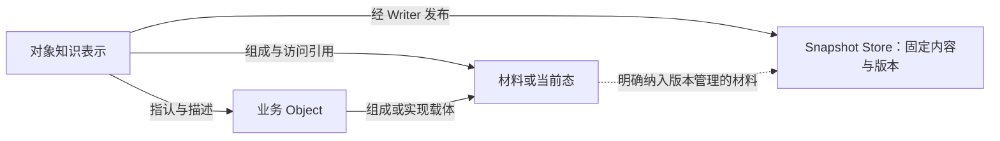
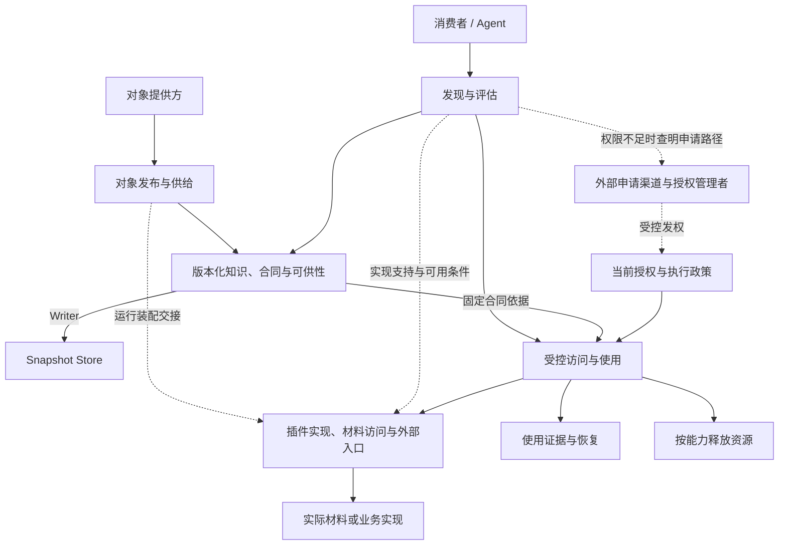

# 对象供给全景与发布发现设计

## Goal

构建面向 Agent 的对象环境：让不同团队发布有身份、有来源、能被理解并按明确合同使用的
业务对象，供人、应用和 Agent 按任务发现、选择、获准与使用，并保留可复核的使用依据。
平台的交付单位是对象供给；知识表示是其版本化公开合同与说明，实际材料、状态和处理
逻辑可以位于不同位置。Agent 是消费方之一，不改变对象身份、知识权威与授权责任。

全景涵盖发布、发现、评估、访问、使用、见证与释放。发布与发现形成可独立交付的切片：
发布者能表达供给，消费者能找到、比较、固定读取与引用对象声明。这个切片不以插件实现
已经交付为前提，也不能把发现声明写成能力已经可用。

本文拥有对象供给责任链、发布发现任务和可供性的语义关系。术语、协议分层、知识写入、
能力注册与执行、检索和授权仍由各自 owner 拥有；产品实现差距归 MVP 验收，执行次序归 TASK。

## Non-Goals

- 不新增第五个协议层、第二套通用对象身份或独立 Object 注册表；供给声明经既有知识写面发布。
- 不内置业务对象类型名单、源系统客户端或领域处理逻辑；扩展通过已有合同与注册的插件接入。
- 不要求每个对象都是智能体、具有协商行为、拥有统一资源包装或为基本发布启用某个插件。
- 不把七项责任变成七个必经请求，不为无状态能力强制创建会话或能力租约。
- 不把签名、声誉、结构合规或自然语言说明当成业务正确性与执行安全的证明。
- 不在本文定义字段全集、命令、错误码或执行状态机；具体形状在公开协议与 Conformance 中选定。

## 业务对象、知识表示与存储载体

Object 是在领域语境中被独立指认、引用和维护知识的业务关注单元。提供方必须能说明其
边界，以及哪些变化后仍算同一个对象。例如，品牌图片资产可以替换原图而保持身份，
一次拍摄则可以把另一张照片视为新对象。存储路径、字节摘要和文件集合不能替领域决定同一性。

对象的知识表示记录它指代谁、是什么、由什么组成、知道什么、依据什么以及如何使用。
沿用现有仓与知识标识定位表示；源表键、模块名称等领域标识在定义中表达，不产生另一套
平台全局身份。同名、同源键或相同内容不能自动合并不同提供方的表示。

Snapshot Store 保存内容与版本；lakeFS 承担这项责任，不承担业务 Object 模型。它可以保存
知识字节和纳入版本管理的材料字节。外部表、运行服务及其当前状态可以继续存在于外部。
普通文件也可以独立交付，不因出现在 Snapshot 中就自动成为业务对象。

Snapshot 以版本化文件、仓登记与 Dataset 组合交付，承接多团队协作和生产使用的内容基础。
Object 在其上组织对象知识与元数据，拥有身份、切面、Schema、来源解释及固定读写合同；
对象元数据作为知识维护，Repository 与 Dataset 自定义资源属性仍归 Snapshot。
对象存储由这些责任共同完成，不增加第二套字节、版本或对象登记权威。

“注册对象”是向环境交付可引用、可发现的业务供给：发布它的知识定义、元数据、来源与
Affordance，关联材料或适用实现，后续按同一身份维护。使用者据此找到对象及其访问方式；
有运行能力的供给再按插件与任务合同完成实际装配、就绪和授权核验。知识发布、实例
生命周期与一次执行分别负责，对象供给不要求全部常驻为进程实例。面向对象的环境组织
目标沿[架构总览](core-architecture.md)；本文继续拥有供给的责任交接。

组成与知识组装分别解释。模块可以引用不同仓的源码、合同和测试；Canonical 只组装同仓
同版本的知识单元，不能沿组成引用自动补读其它仓。对象组成不等于 Dataset 文件组合，
对象身份也不从 Dataset 的交付目录产生。

## 知识表示、Plugin 与 Affordance

| 概念 | 责任 |
|---|---|
| 知识表示 | 对象定义、事实、说明、来源、组成及能力声明的整体 |
| Aspect / Member | 独立维护上述内容，支持集合内的稳定单元；衍生说明也是普通切面 |
| Schema | 约束知识、实现声明和输入结果的结构，不代替业务语义证明 |
| Plugin | 提供真实能力实现，通过系统注册的服务或 hook 参与明确任务阶段，与知识发布分别装配 |
| 可供性（Affordance） | 描述对象供给与系统能力怎样使用，关联明确访问、实现或任务合同，说明用途、条件、效果、风险、成本和示例 |
| 系统注册、服务与 hook | 登记、选择和调用插件贡献；固定目标与范围，执行阶段顺序、输出核验及必要证据保证 |
| Relation | 独立维护关系知识，通过引用连接对象及合同，不隐式读取或授权端点 |

可供性同时面向对象和系统。对象侧说明已发布对象可怎样读取材料或使用其明确实现，
适用条件与选择信息由对象知识表达；系统侧说明基础任务和插件贡献怎样调用，关联已有
任务合同。共同操作语义由合同拥有，两侧不得各自维护冲突的含义，也不能宣称合同以外的能力。

系统定义任务及其阶段，Plugin 提供实际扩展实现。插件按来源 Repo 的 scope 配置与采用，
系统按可信目标明确选择并调用；Dataset 组合来源仓的能力，不安装另一套插件。
声明式索引和 LiveAccess 是已有扩展方向，登记、作用域与运行责任由
[插件扩展 owner](plugin-extension.md)拥有。后续 Wield 等插件可按所属合同接入对象使用，
这里只表达扩展目标，不代表已经交付执行器、审批流程或任意对象执行能力。

CLI/help 是现有任务能力说明的载体，可供性不另建方法分派系统，也不强制统一描述字段。
插件可供性的选定读取入口为 `kc plugin <名称> help`：插件提供说明，统一客户端经 Server
读取；说明读取与目标概览已接线，精确命令与帮助导航沿 [CLI owner](cli.md) 落实。
对象供给中的说明作为版本化知识维护；后续系统出版物中的能力说明仍须显式经 Writer
发布并按固定版本解释。help、可供性或资源元数据都不授予权限、不隐式安装插件，也不
证明实现已装配、当前可用或本次调用已获权。

决策信息应区分实际保证、成本估计和待确认条件。自然语言可供性帮助消费者理解用途，
只有具备明确解释及执行主体的约束才能成为守卫；结构校验不证明前置条件成立。

Schema、能力说明和关系声明可以独立寻址与版本化，但不能因此被自动列为业务供给。
业务对象与合同记录的角色由声明解释，不由文件名、目录、扩展名或索引加载顺序猜测。
普通 Schema 按同仓固定版本解释；跨仓能力合同采用必须有明确来源、版本和允许范围。

现有代码仍使用 InterfaceDefinition、InterfaceRegistration、InterfaceHandler 和同名知识
合同；这些名称按现有代码合同解释。固定版本解析、摘要匹配、输入结果校验、授权与执行
依据继续沿用，扩展实现以 Plugin 组织，基础任务不因此成为插件。本次不更名代码、不改
持久声明，也不为 Affordance 新增另一套描述 Schema。

## 对象供给的责任交接

图表示产品责任，不是新增的协议层、部署进程或统一调用函数。Snapshot（含仓登记与 Dataset）、
Knowledge、Retrieval 的边界保持；对象发布由应用编排，固定文件、知识解释与对象能力访问保留各自
保证。插件装配与当前授权不是知识提交的隐含副作用。

| 环节 | 要交付的结果 | 不能据此推导什么 |
|---|---|---|
| 发布 | 身份、边界、来源、知识及能力声明可按接受版本读取 | 插件已装配、外部来源可达、调用主体已获权 |
| 发现 | 在允许范围找到对象与候选能力，保留选择依据和固定引用 | 命中对象就是能力当前可执行 |
| 评估 | 理解用途、条件、效果与限制，辨明保证、估计和未知项 | 描述真实、业务条件已成立、成本估计可作硬预算 |
| 访问 | 固定明确实现与合同，检查支持及本次权限 | 读到声明就取得执行权，旧授权永久有效 |
| 使用 | 取得实际材料、观察值或操作结果，或明确失败 | 数据能扩大权限，固定声明冻结外部当前值 |
| 见证 | 保留主体、操作、合同、实现及实际结果依据，明确结果未知 | 本地记录与外部副作用天然原子成功 |
| 释放 | 处置能力创建的租约、锁或临时资源；无状态能力没有待释放资源 | 释放会删除知识历史、材料版本或保留证据 |

可用性由声明、实现支持、环境、当前主体和时点共同解释，不能压成永久的就绪标记。
LLM 可以提出操作，执行仍经确定性检查。可变业务条件由源系统在执行时最终确认。
不可逆操作的批准应覆盖具体操作及范围；知识合并 Gate 不自动成为业务执行批准。

Agent 的任务链是发现供给与系统能力、理解并固定合同、确认本次权限、受控使用、留存依据。
缺少许可时，查权结果与可选的外部申请地址帮助它进入所属授权流程；发权仍由授权管理者
通过受控入口完成，平台不托管申请或审批队列，也不因 Agent 已提出请求自动批准。
已有权限可直接进入受控使用，每次请求仍按当前授权检查。使用留痕由所属访问或操作合同
承接，记录固定知识、实际材料或观察及结果；需要沉淀为对象知识时再显式经过 Writer。

外部写入需要源端幂等、结果查询与恢复协议配合。保存执行意图和结果不能凭空形成跨系统
事务；记录失败不能证明副作用未发生。不可篡改见证、能力令牌、委派衰减及租约分别有自己的
保证与采用条件，不能仅从“发布对象”推导它们必须采用某一种实现。

## 发布与发现的独立交付切片

发布者应让消费者辨明对象的指代、边界、用途、来源与组成。信息可以分布在领域切面中，
不强制统一 definition 字段或资源描述符。能力声明与可供性需要明确关联，实现选择不能靠
名称相似或正文提到某项能力来猜测。未采用插件能力的普通知识发布继续成立。

供给发布要区分结构合法与可解释。需要解释的 Schema、合同和实现声明应在固定范围中
能够定位、采用和核对；关系端点、组成材料以及外部当前态不能被混成必须在线的提交依赖。
发布校验不能隐式挂载外仓，不能为验证而安装插件或执行能力，也不能形成跨仓事务。

知识发布与发现就绪分别成立。接受的提交不因索引失败撤销；已知对象可以精确读取。
依赖检索的发现必须检查其依据与可用能力，不能用旧投影解释新内容，不能把未就绪当零命中。

发现按对象任务组织结果：消费者取得对象身份、来源与发布依据，知道命中来自哪个切面、
哪项能力或可供性，并能沿固定引用继续读取。切面是维护单元，不因为它有文件就变成独立
业务供给。合同记录与业务对象应能明确选择，不能把所有知识记录混成一个对象目录。

用途发现、能力发现、类型化条件和关系导航可组合使用。检索方式由任务需要和可验证能力
决定，不预设必须向量化。声明式索引唯一写在 Schema 字段 access；字段身份保留 Schema
与切面上下文，成员内容按独立维护单元解释，不再维护一份“支持能力清单”权威。
发现究竟命中哪个成员，需要相应证据，不能仅从字段命中推导。合同来源及采用版本必须可核对，
不能仅按同名插件能力或不同引用写法的字符串相似度判定能力相同。在固定范围内能够
证明解析到同一合同依据的合法引用写法，也不能仅因字面不同而漏匹配。

发现结果的摘要、选择理由和所谓对象卡片都是同依据知识的交付表达，不能成为第二份正文。
对正文的屏蔽继续遵守发现与读取的独立授权；供给声明的发现不执行所声明的对象能力，
也不为证明其可用性探测外部业务状态。显式动态知识查询仍按既有 State 与观察合同解释。
运行支持信息若另行提供，必须注明其依据、覆盖与有效条件。

## 三类对象的发布与发现

下列名称只说明组织方式，具体字段及查询形状由领域 Schema 和公开协议承接。

| 业务对象 | 知识与材料示例 | 发布发现任务 |
|---|---|---|
| 品牌图片资产 | `logo.definition.yaml` 表达含义和边界，`logo.description.yaml` 表达说明与来源；组成引用固定原图 `materials/logo.png` | 按用途找到图片，回读原图采用依据及声明的材料访问能力；没有图像插件也能理解其供给 |
| 支付模块 | `payment.definition.yaml` 描述职责与组成，`payment.design.yaml` 保存设计说明；代码、合同和测试分别引用不同仓的固定材料 | 按职责或声明能力找到模块，辨明组成和依赖，沿关系定位相关材料；不自动跨仓补齐正文或执行构建 |
| 外部订单表 | `orders.definition.yaml` 表达源标识和口径，字段切面描述含义；能力声明说明 LiveAccess 插件的访问要求 | 按业务口径或能力声明找到表，回读固定说明和访问要求；不连接数据库就推导行数、当前结构或权限 |

图片和模块可以共享固定材料访问合同，外部表可以提供当前态访问；同一对象也可组合多个
合同。用例首先证明声明能够统一解释与发现，领域处理正确性随后由实际插件单独证明。
这些例子不形成核心类型枚举，也不建立与清河数仓相互替代的业务套件。

## 版本与维护

对象的领域身份、知识版本、材料版本和运行观察分别解释。无关知识提交可以改变读取
Snapshot 坐标，而不改变该对象的内容；外部表变化可以改变观察，而不改变访问声明。
固定知识只固定它明确采用的材料引用，不能承诺所有关联资源都有同一全局快照。

衍生说明按真实输入依赖维护：标题变化不必让依赖原图的说明失效，更换原图则需要复核；
更新结果自身不能反复触发同一推导。发布的输入、算法和实际材料或观察依据要可核对，
自动生成、人工修订和索引重建分别承担维护责任，沉淀知识仍走 Writer。

## 硬性约束 / Invariants

- 沿用 I-01 / V-01：身份不按路径改写，一次请求固定声明的来源仓与 commit，不合并来源。
- 材料引用、运行观察及操作结果各自保留对应依据，不能以知识 commit 替代实际使用依据。
- 保留现有 OI-01～05 的保证：实现独立扩展，固定且有界分派，知识不授予执行权，衍生按实际依赖维护。
- 沿用 AUTH-01 / AUTH-03：发现与正文交付保持独立授权，屏蔽不改身份。
- 可供性、说明与返回数据不能改变调用主体、权限或固定执行目标。
- 业务 Object、知识表示与 Snapshot 载体分开；同名、同源键或相同字节不自动证明领域同一性。
- 供给声明、可解释依赖、插件支持、当前可用和本次授权分别成立；发现不能冒充运行验证。
- 继续使用 Schema 字段 access 作为唯一查询声明；投影不是正文，也不是对象注册权威。
- 外部副作用与见证记录不虚构原子性；失败、业务空值、缺能力和结果未知不得互相替代。

## 选定方案 / 被否决方案

选定通过既有知识写面发布对象供给，以 Aspect/Member 维护定义、说明、实现及可供性；
通过固定 Reader、字段查询声明和关系实现发现。否决新增 Object 注册表、领域身份服务、
第二写面、类型 switch 或按存储路径生成业务身份。

选定 Plugin 作为扩展实现实体、Affordance 作为对象供给与系统能力的使用说明，关联明确
访问、实现与任务合同。系统通过注册、服务与 hook 选择并调用贡献；CLI 沿用既有 typed 任务合同与 help 载体。
否决只有自然语言描述就认定能力已实现，或另建一套与任务合同冲突的操作语义。选定发布发现
可独立交付，否决以实现暂缺反向收窄全景，以及要求全部能力实现后才能发布声明。

选定能力相关的获取、授权、执行、恢复与释放保证分别评审；否决强制 ocap、会话、对象
自治、签名或声誉作为所有对象的前置条件。需要这些机制的能力仍应按其合同接入。

## 接口契约 / 状态机

本文定义责任与可观察保证，不新增消息、状态机或公开入口。现有身份和读写形状见
[Knowledge](../../object/README.md)、[Reader](../../object/reader/README.md) 与
[Writer](../../object/writer/README.md)；现有能力声明与执行的兼容合同见
[现有代码合同](../../interfaces/definition.go) 与 [LiveAccess](../../liveaccess/README.md)；
发现合同见 [Retrieval](../../discovery/README.md)、[AccessSpec](../../discovery/spec.go) 和
[索引](../../declarativeindex/projection/README.md)。新供给角色、可供性及能力发现写法在相应公开协议与
Conformance 中选定，不能仅凭本文示意认定已有接口。

## 方向性用例

### U1：发布并发现图片、模块和外部表

发布者分别提交三类对象知识；同一消费者经正式服务入口按用途定位并回读固定供给。
结果保留对象、来源、命中单元及依据，不能以文件条数冒充业务对象数量。

### U2：按共同能力发现对象

图片与模块声明同一合同，说明文档仅提到该合同。能力发现命中实际声明的对象，不能将
提及者混入实现者；跨仓同名合同与不同采用版本仍能辨明。

### U3：发布新知识但发现尚未就绪

Writer 回执仍可用于精确读回；检索未能服务该依据时明确报告，不返回零结果或改读 HEAD。
旧消费范围仍按旧声明发现，不因新版可供性变化改变历史解释。

### U4：能力未装配仍能理解供给

消费者可以发现和读取声明，知道其要求；缺插件实现时不得显示已可用。发现过程不尝试执行
外部操作，也不把缺实现、源失败或无权解释为对象不存在。

### U5：固定供给后实际使用与维护

消费者按固定合同使用已有实现，结果保留实际材料或观察依据；衍生结论显式发布为知识。
需要资源的能力按合同释放，外部结果未知进入可复核恢复，不把描述发布当作此任务已完成。

### U6：Agent 找到供给但尚未获准

Agent 找到外部表的固定声明，并从目标概览及可供性理解所需能力。缺少权限时按可用的外部
申请路径请求授权，由授权管理者决定并发权；获准后仍以实际主体经正式入口使用，外部源
继续检查其权限。结果保留合同与实际观察依据，不能用找到对象、提交申请或读取说明代替成功使用。
