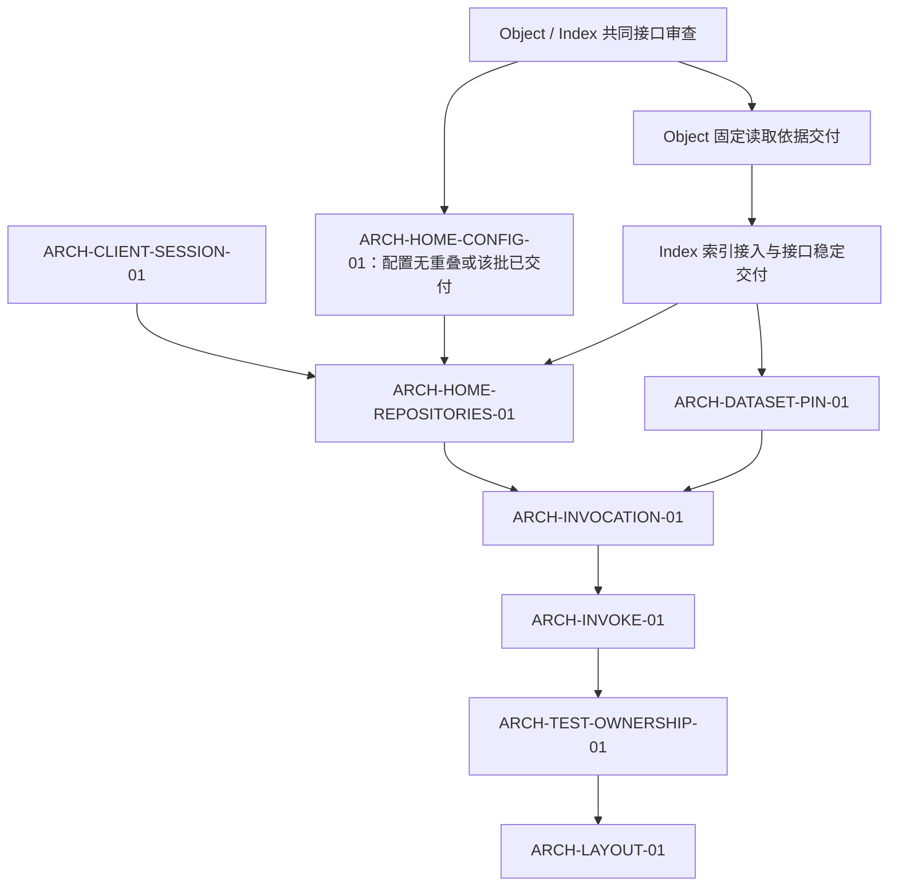

# ARCH-LAYOUT-01 · 能力目录与宿主边界重组总验收

## 目标

保留以能力为中心的目录主干，收清客户端会话、部署装配和应用执行的职责与依赖：
会话归调用方，`home/` 根包只拥有组合与生命周期，`invocation/` 只拥有统一执行和必要的跨模块协调。
模块实现与测试归所属能力；根 CLI 保留真实入口、宿主装配和跨模块集成。

本任务负责目录重组的联合验收；实现分别由下列独立任务交付。原无生产者错误码清理迁入
`ARCH-ERROR-CODES-01`，独立验收，并继续作为 `FINAL-ACCEPTANCE-01` 的前置。

## 依据

- [架构](../../doc/architecture.md)、[路线](../../doc/roadmap.md) 的目录重组表。
- [服务](../../doc/design/service.md)、[权限](../../doc/design/permissions.md)、[插件](../../doc/design/plugins.md)。
- [架构不变量](../../doc/engineering/architecture-invariants.md)、[工程质量闭环](../../doc/engineering/quality.md)、
  [测试与验证](../../doc/engineering/testing.md)。

## 目标布局与实施入口

| 目录或职责 | 目标 | 实施任务 |
|---|---|---|
| `kernel/`、`snapshot/`、`object/`、`discovery/`、`declarativeindex/`、`liveaccess/`、`systemrepo/` | 保留能力主干及各自服务、SDK、CLI；迁移只归还所属职责 | 各迁移任务 |
| `client/session/` | 服务地址、登录、会话持久化、刷新与注销；CLI 与挂载客户端复用 | `ARCH-CLIENT-SESSION-01` |
| `home/config/` | 部署配置、解析与静态校验 | `ARCH-HOME-CONFIG-01` |
| `home/repositories/` | 托管供给、自有连接、凭据轮换、私有账本与恢复 | `ARCH-HOME-REPOSITORIES-01` |
| `home/` 根包 | 装配依赖、恢复资源、请求借用视图、统一启停 | 上述 Home 两项及 `ARCH-DATASET-PIN-01` |
| `internal/datasetbridge/`（拟） | 已解析 Dataset 到对象读取依据的唯一纯转换；不持有运行资源 | `ARCH-DATASET-PIN-01` |
| `invocation/` | 身份与授权协调、固定请求范围、调用所属服务、交付与留证 | `ARCH-INVOCATION-01` |
| `invoke/` 的现有职责 | 按消费者归还调用参数、执行器、HTTP 编解码和遥测；是否保留窄词汇包由实际依赖决定 | `ARCH-INVOKE-01` |
| `cli/` 及各能力测试 | 单模块断言随 owner；根保留真实 argv、身份上下文、宿主与跨模块集成 | 各迁移任务同批完成，`ARCH-TEST-OWNERSHIP-01` 收尾 |

`identity/`、`delivery/`、`observability/`、`hook/`、`server/`、`datasetfs/`、`cmd/` 保持现有职责。
场景与材料仍归 `.data/scenes/`，压测仍归 `.data/scale/`；不为目录整齐改动其组织合同。
目录树不是分层依据：每个新增 Go 包都须显式归层、列明允许依赖，并保留正反架构守卫。

## 共同实施与验收约定

- 实施前记录本项迁移清单：现 owner、目标 owner、生产消费者、公开入口、对应测试和正在修改同一文件的任务。
  审查依据是设计与实际调用，不以文件名、代码行数或测试/生产比例直接判定归属。
- 每次迁移同时迁移对应测试并执行到绿，不把测试交给最后的收尾任务。禁止复制算法、增加私有原样转发、
  为测试扩张公开面，或把新包作为绕过层约束的中转。
- 保留既有 CLI、HTTP、配置、耐久数据及公开 Go 入口的合同。必要的既有公开兼容桥只委派唯一实现，
  不保留第二套状态或规则；行为设计的缺口归相应行为任务，不借目录调整实现新协议。
- 每项完成受影响的模块、入口、架构及公开形状合同，执行 `make check-docs`、`make quality`、
  `make test`、`make test-contracts`，结果全绿且无 skip；同口径记录耦合前后结果，只显式收紧基线。
  路径变化须同步实际测试登记、包 README 与拥有该职责的设计篇。
- 无前置且文件不重叠的任务可以分别推进；共享架构守卫、文档和耦合基线变更按候选顺序合入。
  实施中发现质量问题沿任务约定的三个出口处理，不顺带改动无关存量。

## 验收

- 七项目录子任务达到各自验收；交付实现与原位置的映射，旧 owner 不再持有重复实现。
- 登录与会话的依赖闭包不进入 `invocation`、`home`、`server` 或具体存储/索引实现；业务 CLI 仍经
  Server 与显式主体。部署与 serve 命令的合法装配依赖单独验证。
- Home 的配置和仓管理子包不反向依赖根 Home；请求视图不能启停或关闭根资源。
  `invocation` 不重新实现所属能力的规则，不打开部署或构造具体 provider。
- 三份 Dataset 读取依据转换归一，保留所有既有来源、范围与解释依赖；测试夹具使用同一转换但独立断言预期，
  不从被测实现生成 oracle。
- 测试迁移有前后覆盖对应，原断言、CLI/HTTP 共用执行器、固定版本、当前授权与失败语义仍可证伪；
  不以挪动测试、改名或降低门槛制造通过。
- 在最终同一源码候选上执行共同门禁，保存范围、源码指纹、失败/跳过计数及证据路径。
  子任务的历史绿不能代替此联合验收。真实部署验收由 `FINAL-ACCEPTANCE-01` 及相应行为任务独立完成，
  不把夹具结果报告为部署通过。
- 交付顶层与具名子包目录、实际依赖图、每个目录一句职责、必要公开兼容桥及耦合变化，
  与 `doc/architecture.md`、`doc/design/service.md` 和 `doc/roadmap.md` 逐条核对。这份报告进入
  `FINAL-ACCEPTANCE-01`。

## 前置

本任务开始联合验收前，须完成 `ARCH-CLIENT-SESSION-01`、`ARCH-HOME-CONFIG-01`、
`ARCH-HOME-REPOSITORIES-01`、`ARCH-DATASET-PIN-01`、`ARCH-INVOCATION-01`、
`ARCH-INVOKE-01`、`ARCH-TEST-OWNERSHIP-01`。

项目主线先完成 Object 的固定读取依据基础，再推进索引物理重构与 Object 剩余交付；
ARCH 主要迁移使用行为任务已实现并验证的稳定接口。子任务开工按各自的 `## 前置`，
不要求先完成本总验收任务。

| 推进类别 | 任务 | 开工条件 |
|---|---|---|
| 可提前 | `ARCH-CLIENT-SESSION-01` | 无行为重构前置；共享文件不与主线同时改动，不反向阻塞主线 |
| 可穿插 | `ARCH-HOME-CONFIG-01` | Object/Index 共同接口审查后，确认待迁配置与索引新增持久状态、恢复和生命周期配置不重叠；有重叠则等待该批交付 |
| 后置 | `ARCH-DATASET-PIN-01`、`ARCH-HOME-REPOSITORIES-01` | `OBJECT-VERSIONING-01` 的“固定读取依据交付”和 `INDEX-PHYSICAL-01` 的“索引接入与接口稳定交付”均有实现及回归证据；仓管理另依赖会话、配置任务 |
| 后置 | `ARCH-INVOCATION-01`、`ARCH-INVOKE-01` | 沿下图传递前置；执行器所迁的比较、无变化写入、历史等操作接口也须由原行为任务交付并验证，不迁未定调用链 |
| 最后收尾 | `ARCH-TEST-OWNERSHIP-01`、本任务 | 各迁移及其测试已完成，再核对残留归属和联合候选 |

下图中共同审查、固定依据和索引接口稳定是交付点，其定义分别由 Object 与 Index 任务维护，
不是要求整项任务归档。仅有设计文字、接口草稿或暂时没有同文件修改，不足以放行后置迁移。

会话与配置各自达到开工条件后可分别推进，仓管理随后消费两项交付；这是 ARCH 内部依赖。
只有一条执行线时优先 Object 基础、索引重构及 Object 剩余交付，再做 ARCH 主要迁移。
`ARCH-ERROR-CODES-01` 可先审计，删除等待所属行为合同稳定；它独立验收，和本任务共同进入
`FINAL-ACCEPTANCE-01`，不作为 Object 或 Index 的前置。

`ROUTE-MANIFEST-01`、`LIVEACCESS-READ-01` 已有归档交付，本轮复用，不重复实施。
`INDEX-SEARCH-SPACE-01` 与 Dataset 生命周期任务的相关接口仍按对应批次交付后迁移；
不把它们整项完成追加为所有 ARCH 工作的统一前置。达到上述 Object/Index 交付点后，
每批仍须记录待迁接口、生产消费者、通过的回归和固定源码候选；接口再次调整时重新核对放行条件。
两项行为重构均不依赖 ARCH 完成，不能形成反向等待。

## 不做

不重建全仓分层目录，不改公开行为，不重做路由清单，不改 Dataset 版本与生命周期、索引物理布局或对象版本语义。
不按包体积机械拆包，不为压低测试比例迁走真实入口测试，不预定 `invoke/` 必须删除或只改名。
不把无生产者错误码清理捆入目录迁移。

## 拆分（2026-10-16）

单一路由清单与原并入本任务的 `DEBT-UI-REDIRECT-STATUS-01`（UI 补斜杠跳转状态码随 Go 版本变化）改的是同一份
路由，不依赖目录搬迁和 Dataset 修订重构，拆为 `ROUTE-MANIFEST-01`，原验收条目与并入内容整体转入该任务。
`done/` 中原债的关闭记录写的是并入本任务，按历史保持原样。

## 范围更新（2026-10-20）

按当前目录和用户确认的方案重划任务，仅更新规划，未开始代码迁移。
路由已收口，CLI 的模块归位已有实现与守卫；新增工作聚焦会话、Home 与应用执行边界。
原 DatasetPin 合并验收转入 `ARCH-DATASET-PIN-01`，不再以整个 Home 拆分为前置。
`object/reader` 下沉候选经层表核对不适用：它属于 object 层，不能依赖 dataset 层；
转换采用窄的上层私有桥接，Reader 与 Snapshot 的既有禁止依赖保持。
随后按用户确认的项目优先级补入 Object/Index 的交付点前置：会话可提前、配置可穿插，
读取依据转换、仓管理和执行器主要迁移后置。此项排序调整未开始任何实现或完成任何交付点。
